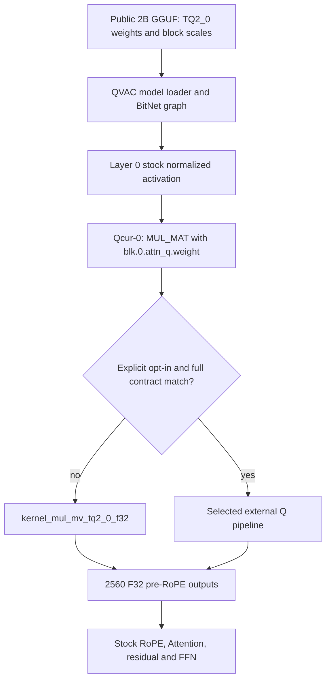

# Source walkthrough

Start with `validation/shaders/matvec.metal` for the independent algorithm, then `validation/reference.cpp` and `validation/main.mm`. Read `shaders/stock4x1.metal` to see the compatible stock-arithmetic specialization. Read `ggml/src/ggml-metal/ggml-metal-ops.cpp` only after the standalone input/output contract is clear.

## The selected Q operation

Logical operator: `Y[r] = sum_k(decode_TQ2_0(W[r,k]) * X[k])`. W has 2,560 rows and 2,560 columns, X is one F32 token vector and Y is a 2,560-element F32 vector **before RoPE**. GGML's `ne[0]` is the input/K dimension, so its dimension notation can differ from row-major mathematical notation.

Each K block has 256 trits packed into 64 bytes plus a two-byte FP16 scale: **66 bytes/block**, ten blocks/row, **660 bytes/row** and 1,689,600 weight bytes in total. Two-bit codes 0/1/2 represent -1/0/+1, multiplied by the block's scale. Code 3 is rejected by the independent fixture validator. TQ2_0 packing must be decoded with its actual plane order, not as four adjacent logical weights per byte.

The model's "1.58-bit" ternary values do not mean this GGUF physically stores one bit per weight. TQ2_0 uses two-bit codes plus a block scale (2.0625 stored bits/weight for a complete block). No new one-bit binary format is claimed.

The CPU reference independently unpacks logical K indices and accumulates in FP64. It deliberately does not reuse the GPU packed-byte coefficient transformation or SIMD reduction. CPU exactness refers to arithmetic on the supplied packed weights and F32 input, not to the unquantized original checkpoint or model quality.

## Where integration belongs

1. `conversion/base.py` and `conversion/bitnet.py`: original checkpoint unpacking/scales and GGUF metadata.
2. `src/models/bitnet.cpp`: graph construction, including the actual ReLU-squared FFN semantics.
3. `ggml/src/ggml-metal/ggml-metal-context.m`: scheduled graph traversal, command-buffer lifetime and optional timing/completion hooks.
4. `ggml/src/ggml-metal/ggml-metal-ops.cpp`, `ggml_metal_op_mul_mat_mv_encode` and guarded FFN encoder: graph/consumer/encoding-boundary guards, Q identity/contract checks, buffer resolution and encoding.
5. `ggml/src/ggml-metal/ggml-metal-device.m`: resolve/cache the pipeline from the selected metallib and check capabilities.
6. `ggml/src/ggml-metal/kernels/mul_mv.metal`: the original `kernel_mul_mv_tq2_0_f32` and stock helper.
7. `bitnet/shaders/stock4x1.metal`: the separate fixed-shape four-row/one-SIMD variant.

The kernel need not physically live inside QVAC's shader directory. Our external metallib route makes it independently buildable, and the guarded encoder integrates it where real W/X/Y become available. A general operator could be reused by many layers, but this **Q route deliberately targets only layer 0**. Shared shapes do not by themselves authorize broader dispatch.

## Buffer and launch contract

The Q guard checks `Qcur-0`, `blk.0.attn_q.weight`, `GGML_OP_MUL_MAT`, N=1, TQ2_0 W, F32 X/Y, audited `ne[]/nb[]`, `add=0`, `norm=0`, offset alignment, full buffer bounds and disjoint input/output ranges. Buffers may share an MTLBuffer handle while their byte ranges are disjoint; a handle alone is not the tensor address.

The stock pipeline has its native argument-buffer ABI. The custom external Q shader instead binds **W/X/Y at slots 0/1/2** with the actual tensor byte offsets. It is not safe to copy the custom bindings into the stock PSO. Actual Q4 launch is grid `[640,1,1]`, threads `[32,1,1]`; actual stock is grid `[320,1,1]`, threads `[32,2,1]`. The historical external symbol `tq2_0_matvec_poc_c8x2` is retained for Q4 despite its four-row layout: inspect the source and launch, not just the symbol name.

Missing libraries, unsupported capability, prefill or mismatched contracts must retain stock. Candidate pipeline cache keys use the function symbol, so use a **fresh process** for different metallibs and missing-library controls.

## FFN research routes

For this model: gate/up each project 2,560 inputs to 6,912 outputs. The activation is **ReLU(gate)^2 * up**, followed by weighted RMSNorm and a stock down projection to 2,560. G combines the two stock-arithmetic projections into one dispatch while retaining separate postprocessing. F8 combines two C8 projections and activation; K additionally experiments with legal in-place postprocessing/normalization. Neither ordinary ReGLU nor SwiGLU is a substitute for the actual graph.

FFN fusion requires graph-edge/consumer and encoding-boundary checks in addition to tensor checks. No dispatch may rely on global synchronization between independent threadgroups. K's historical layers 2 and 29 fell back because the encoding/alias contract did not match; this is a recorded safety boundary, not a claimed 30-layer execution.
