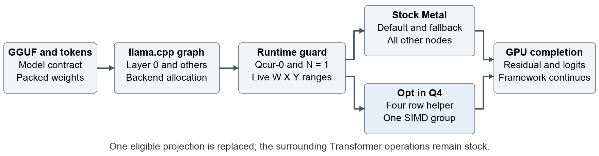

# Mobile BitNet Inference Technical Proposal

**Metal proof of concept and Vulkan portability plan**

Prepared for the Tether technical assessment. Technical plan and measured validation record. Unverified claims and retained failures are explicitly identified. Evidence cutoff 16 November 2026, Asia/Tokyo.

## 1 Executive proposal

We propose a Metal-first implementation of mobile BitNet inference using the existing llama.cpp graph, loader, memory planner and GPU backend. A narrowly guarded matrix-vector kernel replaces one projection inside a Transformer layer, while all unsupported calls retain the stock path. A parallel file-level plan extends and validates QVAC's existing Vulkan support on selected Adreno and Mali devices.

The practical deliverable is a reproducible source package, an independent sample-I/O harness and this technical plan. The implementation uses a public Microsoft checkpoint to establish the development path; acceptance of the team's pretrained checkpoint remains a separate dependency. The source baseline is QVAC commit `2db8b046d555316019ae75d1be90484adc8b9330`. The historical reviewed implementation snapshot is `bbf70e9cc70302534ff87b4f34d4ce52a9670baa`; the tested ActQuant phone binary comes from `4c249e3`, with derived evidence consolidated in `e84732c`. The historical combined ActQuant/Q4 binary uses `edbd109` and has its own scoped qualification. The later launch/cache package from `14a9f103` now passes fresh A16 scoped qualification and local operator checks; formal decode is slower with QB/Q4, while CPU diagnostics identify a large warm snapshot/key region. Section 10 separates these results from earlier binaries. [E7]-[E12] [E1][E2][E14][E15]

| Primary implementation and attribution | Reference and measured scope |
|---|---|
| Original authored 4x2 PoC | Independent TQ2_0 unpack/dot on supplied F32 X; host and physical-phone sample-I/O pass independent FP64. Its full phone graph is not qualified. |
| Q4 stock4x1 specialization | Reuses stock helper arithmetic; layer 0, N=1. Two histories pass all 32 Q FP64 checks and same-build stock residual/logit parity with ActQuant OFF and ON. Earlier ON paired operator reduction is 2.61%-2.68%; the current package measures 2.51%-2.78% locally in the fair cohort. Current integrated ON decode is slower than stock. |
| V2 F32 ActQuant repair | New CPU/Metal quantizer, not a matmul replacement. A16 same-input official-F32 checks pass; complete source-F32-ON layers/logits fail, strict exit 1. Combined Q4 passes its stock-ON compatibility scope, not trusted-model fidelity. |

The original 4x2 PoC now passes fresh physical-iPhone sample-I/O qualification: five input cases, three routes and 38,400 checked values. Q4 alone retains the fresh two-history real-graph acceptance. These prove supplied-input arithmetic and stock compatibility in their stated scopes; neither proves the public model executes Microsoft activation semantics. [E3][E4][E7]

The brief's wording combines "1-bit" and "1.58-bit". We implement ternary BitNet weights, not a binary XOR/popcount kernel. A literal binary-only requirement would need a different representation and acceptance agreement.

<!-- page -->
## 2 Scope and assignment coverage

The selected operation is `Qcur-0`, `GGML_OP_MUL_MAT`, using `blk.0.attn_q.weight` before RoPE. The model executes the surrounding layer through llama.cpp. The custom shader is one linear operation inside that layer; it does not implement an entire Transformer block in one dispatch. Current Q integration permits only layer 0 and one-token decode. [E4]



| Required topic | Report location |
|---|---|
| 1 Mobile low-bit kernel design | Sections 3 and 4 |
| 2 Framework changes and portability | Sections 5 and 6 |
| 3 Profiling method and optimization targets | Sections 9, 10 and 12 |
| 4 Frameworks libraries and SDKs | Section 9 |
| 5 Kernel optimization strategies | Section 11 |
| 6 Success criteria and benchmarks | Sections 7 and 12 |
| 7 Smartphone memory power and compute limits | Sections 11 and 12 |
| 8 Ten day milestones and checkpoints | Section 13 |
| 9 Risks and contingency plans | Section 14 |
| 10 Assumptions and critical dependencies | Sections 3 and 14 |
| 11 Other constraints and submission contents | Section 15 |

Metal is the implemented target. The brief requires source scripts, a technical-plan PDF and a mobile matrix-kernel PoC with sample-I/O validation; it specifies no minimum speedup. Our additional real-graph and timing gates are declared project checks. The delivery chain is model semantics, one physical-phone kernel, an independent harness, guarded real-graph integration, fair performance comparison and reproducible packaging. FFN fusion branches are optional exploration outside that primary qualification. Android execution, energy measurement and team-checkpoint qualification remain planned work. The ten-day schedule is relative to assignment kickoff, not a claim that all archived research occurred within ten days. The required handoff contains source scripts and a PDF; editable sources are included for review.

<!-- page -->
## 3 Model and weight representation

The public compatibility experiment uses Microsoft `bitnet-b1.58-2B-4T`, source revision `04c3b9ad9361b824064a1f25ea60a8be9599b127`. Its 2,412,820,480 unique parameters include a tied embedding counted once. The converted file has 332 tensors: 210 TQ2_0 matrices, one F16 embedding and 121 F32 normalization tensors. It is not the team's checkpoint. [E2][R2]

| Property | Public checkpoint contract |
|---|---|
| Transformer blocks and width | 30 blocks; hidden width 2560; FFN width 6912 |
| Attention | 20 query heads, 5 KV heads, head width 128 |
| Tokenizer and activation | Vocabulary 128256; model tokenizer/template; ReLU(gate)^2 * up |
| GGUF bytes | 1,203,563,808 bytes; about 1.121 GiB |
| SHA 256 | `52257df879ab4366d97228e7bda94a9a3c6a9065ec44e7879a8b87d54e568cd2` |

TQ2_0 represents trits {-1,0,+1} with codes {0,1,2}; code 3 is rejected by the fixture validator. A block contains 256 logical weights, 64 packed bytes and an FP16 scale. Physical storage is 66*8/256 = 2.0625 bits per quantized weight, before other tensors and metadata. The ternary alphabet's ideal information content is log2(3), approximately 1.585 bits. I2_S packing is not interchangeable with TQ2_0. [E2][R1]

For row r and block b, compute the scaled ternary dot product:

```text
y[r] = sum_b d[r,b] * sum_j (q[r,b,j] - 1) * x[256*b+j]
byte = 32*half + lane
j = 128*half + 32*plane + lane
q = (packed[byte] >> (2*plane)) & 3
```

Here half is 0..1, plane 0..3 and lane 0..31. Four fields in one byte correspond to separated logical K positions. The FP64 reference decodes that logical order independently; it evaluates the supplied quantized W and F32 X, not the original unquantized model.

The compatibility patch preserves direct AutoBitLinear scales, avoids requantizing already reconstructed ternary weights and selects explicit ReLU-squared metadata. All 210 converted matrices were audited without trit or FP16-scale mismatches. This storage audit does not establish activation or full-model semantics. [E2]

<!-- page -->
### Public activation contract and confirmed deviation

Microsoft AutoBitLinear applies per-token absmax INT8 quantize/dequantize before the linear dot. In F32 notation, its reference is: [R11][R12]

```text
s = 127 / max(max_j(abs(x[j])), 1e-5)
xq[j] = clamp(round(x[j] * s), -128, 127) / s
y = linear(xq, ternary_weight) * weight_scale
```

Preserve source rounding, clipping, epsilon and intermediate dtype; BF16 and F32 controls are separate experiments. An F32 tensor could contain dequantized INT8 values, so dtype alone cannot prove omission. Here both source tracing and captured-input checks confirm the default baseline graph sends unquantized X into TQ2_0 MUL_MAT. Original scaled Q weights equal decoded TQ2_0 weights exactly in the local control. [E8]

| Same captured Q input | Step 1 | Step 16 | Step 32 |
|---|---:|---:|---:|
| Stock versus unquantized FP64 failing rows | 0/2560 | 0/2560 | 0/2560 |
| X values changed by official F32 ActQuant | 2559/2560 | 2560/2560 | 2559/2560 |
| Stock versus ActQuant FP64 failing rows | 2498/2560 | 2491/2560 | 2502/2560 |

This is a known semantic deviation, larger than ordinary summation drift in this control. The kernel remains valid for the supplied F32 X; the preserved default graph lacks required preprocessing for this public checkpoint; the new opt-in is evaluated separately below. The team's quantizer, scale granularity, rounding and metadata must be obtained separately. No team-checkpoint qualification is inferred.

<!-- page -->
### ActQuant implementation and remaining reference gap

A separate experimental branch now adds default-off `LLAMA_BITNET_ACTQUANT=1`. It inserts four shared quantizers per block, after the appropriate weighted normalizations: Q/K/V input, attention-output input, gate/up input and down input. This gives 120 nodes for 210 projections; the tied lm_head remains unchanged. Dedicated CPU and Metal `GGML_OP_ACT_QUANT` implementations preserve the existing stock shader math settings. Only the new Metal library uses observed Safe/Precise compile options. [E10][E11]

The pinned source-derived Torch F32 eager profile evaluates scale as `(1.0f / absmax) * 127.0f`. Although mathematically equivalent, direct `127.0f / absmax` differed by 1 ULP on some rows and produced two wrong integer codes in the first real-graph capture. Those failures and a seven-value counterexample are retained. The repaired evaluation order passes both the expanded fixtures and every captured quantizer on its own actual input; this is not a claim about every Torch compiler or dtype profile.

| Mac and physical iPhone numerical evidence | Result and scope |
|---|---|
| Independent CPU and Metal operator fixtures | 20 cases, 386,567 values per backend on CPU, M2 Pro Metal and A16 Metal; all outputs bitwise match the official F32 profile. Includes ties, epsilon, dense inputs, real steps 1/16/32 and boundary regressions. |
| Repaired teacher-forced graph | Per device on M2 Pro and A16: 3,960 actual ActQuant captures, 25,581,568 values; all outputs bitwise equal to official F32 ActQuant on their same actual inputs. 31/31 layers offloaded. |
| Backend regression | ACT_QUANT 16/16 and original TQ2_0 MUL_MAT 59/59 pass on M2 Pro MTL0; these are separate from the A16 app harness. |
| Full-model reference | Complete teacher logits and layer outputs still exceed the frozen bound; strict exit 1 remains. Local ActQuant correctness does not establish full-model numerical equivalence. |
| Small 128-target corpus | A16 ON PPL 19.127702, OFF 19.088221; source-derived F32 ON PPL 19.129530. This is a small quality smoke, with no acceptance or improvement claim. |
| Physical iPhone for this new build | iPhone 14 Pro, iOS 27.2.1, Apple A16 GPU; signed build from 4c249e3. All 6/6 app runs complete with native exit 0; model comparison remains strict exit 1. New performance is unmeasured. |

The switch-off logits remain bitwise identical to the saved baseline, and diagnostic capture versus plain execution produces identical logits. No original CPU/Metal or complete-FFN failure is overwritten. F32/BF16, per-token ActQuant, CPU's additional blockwise Q8_K packing, prefill/decode arithmetic and KV precision remain distinct controls. The remaining stock-model reference drift must be localized before promoting a faithful-inference claim. That historical numerical campaign made no Mac performance claim; later Mac attribution is a separate supplement in Section 9.

<!-- page -->
## 4 Kernel design and sample validation

For the Q projection, W has 2560 output rows and K=2560. Ten 66-byte blocks per row give 660 bytes per row and 1,689,600 bytes total. X and Y each contain 2560 contiguous F32 values, or 10,240 bytes. The kernel never expands the complete weight matrix to F32.

The original authored PoC loads eight X values per lane/block, decodes the packed trits, applies each output row's block scale and accumulates into four independent row sums. A SIMD reduction writes one value per row. X is reused across rows. The reference implementation uses independent FP64 accumulation. [E3]

| Path | Rows per SIMD group | Groups per threadgroup | Grid x | Attribution |
|---|---:|---:|---:|---|
| Actual stock | 4 | 2 | 320 | Existing QVAC implementation |
| Original PoC | 4 | 2 | 320 | Independently authored direct unpack/dot |
| Q4 stock4x1 | 4 | 1 | 640 | Reuses complete stock helper arithmetic |
| C8 research | 8 | 2 | 160 | Separate packed-mask algorithm; model compatibility fails |

Stock and Q4 both launch 640 SIMD groups and 20,480 threads in total. Q4 changes threadgroup grouping from two SIMD groups to one; it does not increase per-SIMD activation reuse.

All configurations use 32-lane SIMD groups on the measured Apple devices. Earlier phone binaries used a shared entry containing `c8x2`. The current revision uses distinct versioned entries: Q4 is `tq2_0_matvec_stock4x1_v1`, with an exact 4x1 host/shader contract; C8 accepts only its declared 8x2 contract. Host geometry alone cannot make a different compiled shader compatible. Current A16 contract/cache checks pass 18/18 cases in each of two processes; both-history live graph qualification passes the declared scope. [E14][E15]

### Hand computable input and output

The fixture sets zero weights to code 1 and uses changing block scales. At row 0, block 0, byte 0x24 supplies codes [0,1,2,0] at columns [3,35,67,99]. X there is [1.25,4,2,-0.5], with scale 0.5. Its contribution is 0.625. A second-block +1 weight at column 385, scale 0.25 and X=3 contributes 0.75. [E3]

| Expected output | Value and purpose |
|---|---|
| y[0] | 1.375; signed/zero trits and multiple scales |
| y[1] | 0; nonzero trit with a zero block scale |
| y[2559] | -1.25; final-row coverage and negative weight |
| All other 2557 values | 0 |

Additional cases use dense seed 42 and actual pre-RoPE inputs from decode steps 1, 16 and 32. All 2560 rows are checked, including finite values, canaries, unchanged inputs and GPU completion. There are 2558 zero outputs in total, including y[1].

<!-- page -->
## 5 Metal integration and source changes

The existing loader, graph and backend remain responsible for allocation and scheduling. The opt-in route is evaluated inside `ggml_metal_op_mul_mat_mv_encode`. It resolves the actual W/X/Y buffers and offsets on each eligible invocation. Candidate slots are W/X/Y at 0/1/2; stock uses args/W/X/Y at 0/1/2/3. These ABIs must not be mixed. Backend filenames below share the prefix `ggml/src/ggml-metal/`. [E4]

| Modified upstream file or module | Responsibility |
|---|---|
| `conversion/base.py` | Direct public-checkpoint scale reconstruction; preserve legacy handling |
| `conversion/bitnet.py` | Offline ternary conversion and activation metadata |
| `src/models/bitnet.cpp` | Select existing ReLU-squared FFN graph from explicit metadata |
| `ggml/include/ggml-metal.h` | Replay and diagnostic interfaces |
| `ggml-metal-context.m` | Opt-in command-buffer timing and completion hooks |
| `ggml-metal-device.h` and `.m` | External pipeline declaration, load/cache and capability checks |
| `ggml-metal-ops.cpp` | Graph/shape guards, live bindings, dispatch, readback and stock fallback |

The last four rows live under the GGML include or Metal backend directories. Together these are eight changed upstream files at that historical snapshot. The new ActQuant branch adds the GGML operation API/core, CPU and Metal backend files, `act_quant.metal`, graph placements and backend tests. New kernels, harnesses, iOS staging and analyzers are under `bitnet/`. QVAC already supplied TQ2_0 kernels and the SwiftUI example; those are credited as existing infrastructure.

The Q guard requires the exact MUL_MAT node and layer-0 Q weight, N=1, TQ2_0/F32/F32, audited ne/nb, no view, add=0, norm=0, compatible pipeline and launch, aligned live offsets and complete byte-range bounds. X and Y may share a Metal buffer only when their byte intervals are disjoint. W/Y overlap is rejected. Other layers, prefill, incompatible contracts and failed library/geometry selection return to stock before custom writes.

The new default-off `LLAMA_BITNET_ACTQUANT_Q4=1` permission is restricted to ActQuant ON, layer-0 Q, rows=4 and SIMD groups=1; it checks the live quantizer producer and does not authorize C8 or FFN. Its two-history joint phone qualification passes the declared stock-ON scope; trusted-reference failure remains separate. [E12] Historical phone controls prove missing-library and unsupported-geometry fallback. Normal-run strides are checked; a malformed real graph stride was not injected. That historical cache used a function-name key. The current cache binds canonical path, versioned entry, launch contract and current file identity before lookup; same-process wrong-library, deletion and replacement controls are covered on Mac. The current source-bound A16 cold and second-process contract checks each pass 18/18 cases; both-history graph checks also pass. [E14][E15]

Current contract headers are `ggml-metal-bitnet-q-config.h` and `ggml-metal-bitnet-q-contract.h`; the Python configuration reader is `bitnet/q_kernel_contract.py`. This additive safety revision preserves shader arithmetic and stock defaults. [E14]

An unconditional residual-ADD binding correction selects the other operand by tensor identity. Thus "stock default" means stock shader/dispatch selection; it does not mean the CPU backend is byte-identical to pristine QVAC. The historical compatibility, readback and review patches describe that eight-file snapshot, not the complete current diff. [E1][E4]

<!-- page -->
## 6 Vulkan extension for Adreno and Mali

The pinned QVAC backend already contains TQ2_0 Vulkan matvec support. The proposed Android work audits and specializes that implementation, rather than starting a new runtime. Metal results do not establish Android correctness or speed. [R1][R6]

| Existing file under `ggml/src/ggml-vulkan/` | Proposed extension or validation |
|---|---|
| `ggml-vulkan.cpp` | TQ2_0 pipeline selection, device/shape variants and fallback |
| `vulkan-shaders/mul_mat_vec_tq2_0.comp` | Same-input ternary matvec and row/workgroup variants |
| `vulkan-shaders/types.glsl` | Confirm packed 256-value block and FP16 scale ABI |
| `vulkan-shaders/vulkan-shaders-gen.cpp` | Generate and register only required specializations |
| `ggml-vulkan-push-constants.h` | Preserve dimensions, strides and offsets in the native ABI |
| `ggml-vulkan-buffers.cpp` and `CMakeLists.txt` | Allocation/staging limits and reproducible NDK/SPIR-V build |

The first Android milestone is an unchanged stock Vulkan build, target feature inventory and public-model functional test. Then port the independent logical-K reference and the same sample cases. Only after stock passes should a shape-specific variant be enabled behind an explicit runtime guard. Add targeted shapes to `tests/test-backend-ops.cpp`; use CPU fallback if the device cannot implement the required operation safely.

Query compute queue/timestamp support, subgroup size and operations, workgroup limits, shared memory, descriptor/offset alignment, memory heaps and narrow-storage/FP16 features. Use subgroup reductions only when supported; otherwise use a conservative workgroup/shared-memory reduction with legal barriers. Do not assume a 32-lane subgroup on every Adreno or Mali. Integer dot instructions, subgroup-size control and cooperative matrices are optional device-specific variants. [R6]

For decode, prioritize packed streaming and activation reuse; for prefill, use matrix tiling and reuse weights across tokens. The current Q PoC is decode-only, so prefill stays stock. Build separate specializations instead of forcing GEMV geometry onto GEMM.

On Android, host-visible memory is not automatically cache-coherent. Validate staging, flush/invalidate rules, descriptor bounds and synchronization. Start with F32 activation/accumulation; treat reduced precision or activation quantization as a separate numerical change. Validation requires one physical Adreno and one physical Mali configuration before making cross-vendor claims. Devices and driver access are critical dependencies, not completed deliverables.

<!-- page -->
## 7 Correctness and acceptance protocol

Validation is hierarchical. The frozen experimental numerical rule remains unchanged:

```text
abs(actual - reference) <= 2e-4 + 2e-5 * abs(reference)
```

This is a project criterion, not a numerical tolerance specified in the brief. Each stage must declare its reference and required scope. A lower FP64 dot error does not establish stock-relative model compatibility. [E3][E5]

| Gate | Reference and required evidence |
|---|---|
| Storage and execution | Correct packing/scales, hashes, all writes, finite values, canaries, unchanged inputs and completed GPU work |
| parity_pass | Same captured W/X through named routes; bitwise differences and tolerance differences both retained |
| fp64_pass | Independently unpacked FP64 dot, or explicitly declared complete FFN chain |
| model_output_pass | Route-specific reference: Q4 versus same-build stock OFF or ON; ActQuant versus trusted source F32 ON, for declared residuals/full logits and KV settings. These are different gates, not language-quality acceptance. |
| Overall result | Every required gate for that mode must pass; missing checks stay null |

Exit 0 denotes a scoped pass or completed analysis, 1 an observed failure, and 2 missing/invalid evidence; some standalone utilities use 3 for malformed input. Check the named tool policy and stored strict verdict. The device orchestration runner can also return 1 for setup/transport errors: inspect execution_pass, native completion, actual app exit and the saved summary before classifying that failure. Processing-only exit 0 cannot overwrite a strict numerical failure. Positive, nonfinite, missing-output and invalid-hash controls check the verifier semantics.

Clean builds from the pinned source, without old dylibs, tested actual stock, original PoC and Q4 on the hand case, dense seed 42 and real steps 1/16/32: 38,400 values passed, with no failing/nonfinite rows. Q4 equaled stock on all 12,800 compared values; original PoC differed in 10,122 F32 values but stayed within FP64 tolerance. TQ2_0 backend regression passed 59/59, with zero selected failures/unsupported cases. These are host numerical results, not Mac performance evidence. [E3]

Real-graph validation checks all 32 eligible Q calls, not only three samples. W is read once per route, X/Y at every step and residual output at steps 1/16/32. The independent analyzer rejects mismatched W/X hashes before comparing outputs. Probe-off and within-process repeats must preserve all 33 complete logits vectors. Timing uses a separate uninstrumented run.

For FFN, distinguish FP64 down on each route's actual input from a full FP64 gate/up -> ReLU-squared -> weighted RMSNorm -> down chain. Existing full-chain failures in stock and candidates remain failures; fusion parity cannot erase them. The 798/880 counts are normalized activation-error diagnostics, not weighted-RMSNorm output failures. A strict failure alone does not establish a bug or unacceptable language quality.

### Meaning and limits of the numerical rule

Bitwise agreement is appropriate for unchanged PSOs with identical W/X, copies and packing controls. A changed reduction may legitimately differ in FP32; retain bitwise counts but apply the declared tolerance separately. For sequential sums, gamma_K = K*u/(1-K*u), with F32 u=2^-24, is about 1.5261e-4 at K=2560 and 4.1216e-4 at K=6912. It multiplies the sum of absolute terms; it is not a relative-error allowance. Cancellation, coefficient transforms, FMA and actual reduction topology affect the bound. These estimates explain sensitivity without replacing the frozen empirical rule. [E9]

ReLU(gate)^2*up amplifies projection error; RMSNorm couples coordinates. Operator FP64, full-chain FP64, stock-relative outputs and trusted-model semantics answer different questions. Predeclare product NLL/PPL and task budgets with document-level uncertainty on a separate validation set. V1 failures remain.

<!-- page -->
## 8 Physical device functional and numerical results

Historical smoke runs used iPhone 14 Pro/A16, iOS 27.0.1, Xcode 27.2 and iPhoneOS SDK 27.2. Loading, generation, offload and KV placement are separate outcomes. [E2]

| Model and framework | Load | Generation | Metal placement | KV placement |
|---|---|---|---|---|
| Patched 1.27B regression | Pass | 32 tokens; exit 0 | Apple A16; 25/25 offload | MTL0; 96.00 MiB |
| Public 2B stock baseline | Pass | 32 tokens; exit 0 | Apple A16; 31/31 offload | MTL0; 37.50 MiB |

The transferred GGUF hash was checked on the phone. Public 2B text begins "A GPU, or Graphics Processing Unit, is a specialized hardware component..."; exact output is preserved locally. This smoke did not save phone token IDs, so text agreement is not token-ID parity. Its older thread/batch defaults are not retroactively replaced by the later replay configuration.

### Q4 layer zero acceptance, OFF and repaired ON

The 15 November ActQuant-OFF campaign used iOS 27.2.1, Xcode 27.2, SDK 27.2 and a fresh framework. The 16 November joint build from `edbd109` uses ActQuant ON and the same configuration: 27-token prefill, 32 fixed continuation IDs, context 512, batch/ubatch 128, six threads, F16 K/V and no flash attention. Only Qcur-0 is replaced. [E5][E12]

| History and ActQuant profile | Custom encode and completion | S plus Q4 decode values | Failed or nonfinite | Max FP64 absolute error |
|---|---|---:|---|---:|
| Primary, OFF | 32 / 32 | 163,840 | 0 / 0 | 1.576802e-5 |
| Independent, OFF | 32 / 32 | 163,840 | 0 / 0 | 1.324259e-5 |
| Primary, ON | 32 / 32 | 163,840 | 0 / 0 | 1.267947e-5 |
| Independent, ON | 32 / 32 | 163,840 | 0 / 0 | 1.267150e-5 |

ON stock/Q4 share identical W and actual quantized X. All 32 decode Q outputs per route pass FP64; prefill is parity-only. All 33 captured Q outputs, 33 layer-output vectors and 33 complete logits vectors match stock ON bitwise, with neutral probe/plain controls. Each history preserves 30 stock prefill and 928 non-target decode Q calls; 32 target custom dispatches complete. Missing-library runs fall back 32 times, custom 0, with unchanged logits. Six CPU-only startup guards separately check valid/rejected configurations. The M2 Pro numerical replay also passes; those runs made no Mac performance claim. The separate focused Mac experiment is reported in Section 9. The scoped parity/FP64/stock-ON model-output gate exits 0. This does not pass full-Transformer FP64, trusted-source model fidelity or quality. Joint corpus/PPL is unmeasured.

### Original authored shader on the physical phone

The exact original `tq2_0_matvec_poc` source, SHA-256 `db8b1fd40120adee0bf2f8bc4db01ef7e7edf11692d285e143fa15f24c408b84`, was freshly compiled and run on A16/iOS 27.2.1. Stock, original 4x2 and Q4 each tested hand-known, dense seed 42 and real steps 1/16/32. All 15 dispatches completed; 38,400 outputs were covered and finite, with zero FP64 failures and unchanged inputs/canaries. Maximum original-PoC absolute error was 5.516948e-6. Q4 matched stock bitwise; original arithmetic differed while meeting the frozen local bound. Independent CPU recomputation and binary/source checks passed. [E7]

A second run uses official-ActQuant-derived X for the three captured inputs. It also passes local FP64. These are derived fixtures, not captures from a repaired ActQuant graph. This closes original-shader phone sample-I/O qualification only; original-PoC real-graph and model-semantic acceptance remain separate.

### Trusted-source teacher forcing and current A16 diagnostics

The CPU reference streams one decoder layer at a time and executes arithmetic extracted from pinned official Transformers source, with compilation/decorator plumbing removed. It uses the original packed weights and exact token IDs. F32 losslessly promotes checkpoint BF16 parameters; BF16 and F32 remain separate profiles. The earlier source-only CPU ON/OFF token-18 margins were +0.094944/-0.005909. That control demonstrated a reference-profile ranking change, not a repaired iPhone decision. [E8]

The new A16 signed build from `4c249e3` completes teacher OFF, teacher ON/captured, teacher ON/plain and corpus OFF/ON; all native exits are 0 with 31/31 offload. Teacher uses 27 prompt IDs plus 32 fixed continuation IDs and saves 33 logits vectors; corpus scores 128 test-split targets. Context 512, batch/ubatch 128, six threads and F16 KV are fixed. Capture/plain teacher logits match bitwise. [E11]

| Current A16 and trusted-source profiles | A16 ActQuant OFF | A16 ActQuant ON | Source F32 ON |
|---|---:|---:|---:|
| Teacher token 18 computations-minus-graphics logit | -0.005144 | -0.030209 | +0.094944 |
| Teacher token 18 greedy choice | graphics | graphics | computations |
| Teacher greedy agreement with source F32 ON | 31/33 | 31/33 | 33/33 |
| Teacher full-logit RMSE versus source F32 ON | 0.251979 | 0.174339 | 0 |
| Corpus 128-target PPL | 19.088221 | 19.127702 | 19.129530 |

At input position 43, after the shared 17-token continuation prefix, ActQuant ON still chooses graphics. The local repair does not restore the reference decision. All 3,960 captured quantizers match official F32 on their own actual inputs, but residuals and full logits fail the frozen source-F32-ON comparison: model_output_pass=false, strict exit 1. No full-chain FP64 or quality pass follows.

Independent FP64 logsumexp rescoring supplies the PPL values. The tiny WikiText-2 slice is not a representative quality benchmark or proof of no pretraining overlap. F32 OFF reference PPL is 19.088566; a lower OFF score does not justify omitting required ActQuant. F16 KV, prefill activation narrowing and quantization thresholds remain distinct propagation controls; existing Mac localization is indexed separately. [E10][E11]

The historical CPU/Metal free-generation result remains CPU generation pass, Metal generation pass and token parity fail, strict exit 1; its token-18 margins were +0.010254/-0.004967. CPU blockwise Q8_K rounding differs from Microsoft per-token ActQuant. This old run and its failure remain unchanged by the new diagnostic build.

<!-- page -->
## 9 Profiling method and development stack

Use three distinct timing scopes: CPU selection/encoding, completed GPU command-buffer elapsed time, and synchronized application wall time. For an isolated operator, one command buffer contains one target dispatch; read `gpuEndTime-gpuStartTime` only after completion and convert seconds to microseconds. This is not pure shader cycles. [R4]

Each formal operator comparison uses identical resident W/X, 30 warmups per route, 201 alternating AB/BA pairs per round and three rounds. Save p50, p95, paired candidate-minus-stock median, wins, order groups and chronological blocks. A/A is calibration and is never subtracted. Separate nominal endpoints from sustained-load cohorts. Disable capture, readback and diagnostics during timing.

| Stack | Role and status |
|---|---|
| QVAC llama.cpp and GGML | Pinned graph, loader, CPU/Metal/Vulkan backends; implemented |
| Git CMake Clang and Python 3.10 or newer | Reproducible builds and analyzers; NumPy for full Q analysis |
| Isolated conversion environment | Python 3.11, PyTorch, Transformers, tokenizers, safetensors, NumPy and pinned in-tree gguf-py; versions in BUILD_AND_RUN.md |
| Full Xcode and Metal compiler | Metal/AIR/metallib and iPhoneOS arm64 framework; measured Xcode 27.2 |
| Apple SDK frameworks and devicectl | Metal, Foundation, Accelerate, UIKit and SwiftUI; signing, deployment and fixed-token replay |
| Xcode GPU Capture and Instruments | Pipeline/launch/dependency verification, Metal System Trace and CPU/memory profiling |
| Android SDK NDK CMake and adb | Proposed Android arm64 packaging and deployment |
| Vulkan loader headers shaderc or glslang and SPIRV Tools | Proposed shader build, validation and feature-specific pipelines |
| APA AGI and Perfetto | Proposed supported-device Android system/frame profiling; APA is current recommended system option |
| Qualcomm Snapdragon Profiler and Arm Performance Studio | Proposed vendor-specific counters; Mali Offline Compiler for static estimates |

Historical conversion used torch 2.11.0, transformers 5.10.0, NumPy 2.2.6, tokenizers 0.22.2 and safetensors 0.8.0. The transformers version was yanked; preserve it only in an isolated reproduction environment and validate replacements separately. Synthetic kernel tests do not require those packages.

Xcode counters can serialize passes, so profile/capture runs are separate from formal timing. AIR confirms intermediate-code changes, not hardware stalls, bandwidth or occupancy. ALU, bandwidth, occupancy, register-pressure and stall counters remain unavailable. A separate M2 Pro stage-boundary timestamp probe works, but changes encoder/fence scheduling; it is not in the normal or phone build and does not establish normal critical-path share. [E13] A failed counter collection records a tool/device restriction; it is not evidence of a memory, ALU or occupancy bottleneck. Supplement with matched shape/launch scans and controlled load/compute microbenchmarks. The same-fixture guard-only control uses actual stock PSOs and is documented in [E9]. [R5]

Android tooling requires compatible OS/driver permissions and a debuggable application; APA is currently public beta. Validate exact tool versions on the selected device. Use AGI/Perfetto or vendor tools when supported. Deployment instructions and tool availability are not measured Android results. [R7][R9][R10]

<!-- page -->
### Selected target and bottleneck evidence

The selected `Qcur-0` operation is the real layer-0, single-token `TQ2_0/F32` Q projection, with `N=1` and `2560 x 2560` weights. Its audited buffers and bounded integration satisfy the matrix-kernel PoC within a transformer layer. It was selected for a defensible contract and reusable low-bit arithmetic, rather than an established whole-model bottleneck. The following measurements are **M2 Pro supplements**, not A16 mobile performance results. [E13]

The model contains 210 ternary projections and 60 structurally matching square weights. These counts indicate possible reuse; they do not measure latency share or qualify additional nodes.

For an idealized cost share `f` and local speedup `s`, Amdahl's relation is `S_total = 1 / ((1 - f) + f / s)`. Here `f` under normal scheduling remains unknown. An isolated operator improvement cannot establish an end-to-end benefit, particularly when host checks and GPU scheduling also change.

| M2 Pro observation | Measured result | Interpretation |
| --- | --- | --- |
| Isolated stock / Q4, real step-16 W/X | Stock p50 23.50 us; Q4 p50 21.50-21.54 us; median paired reduction 8.30%-8.36% | Single-dispatch GPU command-buffer elapsed; excludes guards, ActQuant and model scheduling |
| QB minus stock, fixed 32-token wall | Paired median +0.98 to +3.38 ms | Full guard/lookup path followed by the same stock PSO; no whole-model gain |
| Q4 minus stock, fixed 32-token wall | Paired median +0.10 to +1.96 ms | Candidate integration was slower in this campaign; Mac thermal state was unavailable |
| Selected stock-Q encoder diagnostic | p50 24.459-24.792 us | Timestamped encoder interval with changed encoder/fence boundaries; not normal critical-path share |

In one warm primary diagnostic path, identity/snapshot-key work took 1.109 ms across 32 calls, within 1.135 ms for the complete getter. These nested host elapsed regions identify a substantial component of that getter; they do not additively explain wall latency. The historical +10 to +13 ms screen used a different source/campaign and is not attributed by these numbers.

The tied F16 embedding/output tensor occupies approximately 656.7 MB, about 55% of GGUF storage. This justifies checking output projection, but does not prove it dominates traffic or runtime. No bottleneck elsewhere has been established. Preserve the selected PoC and its local gain; use system profiling to limit claims to the measured scope before broadening optimization. [E13]

<!-- page -->
## 10 Measured iPhone performance

### Earlier qualified ActQuant-ON operator

A fresh A16 step-16 W/X capture from the joint graph supplies this direct stock/Q4 comparison. The signed app and Q4 library match the passing joint build. Each path warms 30 times, then alternates 201 pairs per round for 3 rounds, with comparison order rotated and capture/readback/diagnostics disabled. The metric is completed single-dispatch GPU command-buffer elapsed time in us. Quantizer preparation, CPU encoding, full decode and energy are excluded. [E12]

| Round | Stock p50 / p95 us | Q4 p50 / p95 us | Paired Q4 minus S us | Q4 wins |
|---|---|---|---:|---:|
| 1 | 225.0000 / 228.7917 | 218.7917 / 223.1250 | -5.9167 | 195/201 |
| 2 | 224.7500 / 228.8750 | 218.2917 / 223.9583 | -5.9583 | 197/201 |
| 3 | 224.5000 / 228.6250 | 217.9583 / 222.5000 | -5.8750 | 196/201 |

The medians of per-pair relative changes are -2.6089%, -2.6754% and -2.6509%; these are not ratios of marginal medians. Both execution-order groups and all three chronological blocks per round favor Q4. A/A paired medians are -0.4167/-0.2500/-0.2083 us. All 18 campaign thermal endpoints are nominal, charging at 100%, low-power mode off; the approximately 2.90-second campaign is not a sustained-load study. This establishes a small isolated-operator benefit on actual post-ActQuant X. Full-decode performance of that earlier ActQuant-ON binary was UNMEASURED; the current package is evaluated separately below.

<!-- page -->
### Current A16 package qualification

The signed package from native source `14a9f103` has now passed the scoped physical iPhone 14 Pro/A16 correctness gates on iOS 27.2.1. This is new package-specific evidence, separate from the earlier `edbd109` results. No native code or shader arithmetic was changed to repair the host controller's import environment. The completed build-bound gate and independent CPU audits are recorded in [E15].

Cold and second-process contract/cache checks each pass 18/18 cases. The 20-case ActQuant prerequisite checks 386,567 outputs: zero official-F32 bitwise differences, recovered-code mismatches or frozen-tolerance failures, with canaries intact. Recovered codes are reconstructed from exported F32 outputs and the reference scale; internal integer registers were not observed.

Both histories use the frozen public GGUF, ActQuant ON, F16 KV, 27-token prefill and 32 fixed continuations. Each history checks 163,840 single-token S/Q4 values against the independently unpacked FP64 reference, with zero failures. Prefill is parity-only; this is not a full Transformer-block FP64 check. Maximum absolute error is 1.267947e-5 for primary and 1.267150e-5 for independent. All 33 logits vectors match stock-ON bitwise; saved boundaries, capture/plain neutrality and missing-library fallback also pass.

| Check | Current result | Status |
| --- | --- | --- |
| S correctness | Both histories: all 32 eligible Q calls pass FP64; all 33 logits vectors retain stock parity | PASS |
| QB control | Both histories: 32 full guard passes, 0 custom dispatches; same actual stock PSO, ABI and live bindings | PASS |
| Q4 correctness | Both histories: 32 custom dispatches/GPU completions; all 2,560 rows per call pass FP64; stock/residual/logit scope passes | PASS |
| AA wall | Both histories: paired medians change sign; retain order/time and thermal strata | MEASURED CONTROL |
| SQB wall | Both histories: all formal rounds slower than the paired stock route | MEASURED REGRESSION |
| SQ4 wall | Both histories: all formal rounds slower than the paired stock route | MEASURED REGRESSION |
| CPU checks and encoding | Nested guard/getter/snapshot regions measured in separate diagnostics | PASS, diagnostic scope |
| Natural CB evidence | Completed native intervals retained; selected-Q GPU share remains unknown | PASS, diagnostic scope |
| Local stock/Q4 operator | Three new direct rounds pass the declared numerical and measurement gates; detailed results follow | PASS, local scope |

The wall protocol uses 2 complete-replay warmups per route and 3 rounds of 21 balanced pairs per contrast, restoring the same prefix outside timing. Formal wall samples disable capture, readback and metrics; power/thermal and order/time strata remain part of the analysis. The completed formal and diagnostic results are reported below with their respective scopes. Passing native processes alone do not establish these measurements. The original trusted-reference model comparison remains a completed **FAIL**, strict exit `1`; neither this stock-relative qualification nor the new local timing repairs that result or establishes language quality. The first auditor's incorrect scale-offset assumption was preserved and corrected on CPU; it did not change the fixture, native binary or frozen acceptance. [E15]

<!-- page -->

### Current A16 single-operator timing

The new accepted phone run supplies fresh step-16 pre-RoPE W/X. The selected `tq2_0_matvec_stock4x1_v1` library matches the qualified real graph. S/Q4 qualification on steps 1/16/32 has zero FP64 failures and zero stock-bitwise differences. An additional C8 comparison is isolated research, not new C8 model acceptance. [E15]

Each path receives 30 warmups, followed by 201 alternating pairs per round for 3 rounds. The following table reports only direct S/Q4 groups, with a single dispatch per command buffer. Read `GPUEndTime - GPUStartTime` after completion and convert seconds to microseconds. Capture, tensor readback and diagnostics are disabled during timing. ActQuant preparation, guard/cache checks, CPU encoding and model scheduling are excluded.

| Round | Stock p50 / p95 us | Q4 p50 / p95 us | Paired Q4 minus S us | Paired change | Q4 wins |
| --- | --- | --- | --- | --- | --- |
| 1 | 225.333 / 229.583 | 219.250 / 222.875 | -5.667 | -2.509% | 196/201 |
| 2 | 225.083 / 229.375 | 219.333 / 222.875 | -5.833 | -2.596% | 200/201 |
| 3 | 225.125 / 229.000 | 218.625 / 222.250 | -6.250 | -2.775% | 199/201 |

Percent changes are medians of per-pair relative changes, not ratios of marginal medians. Both AB/BA groups and all three chronological blocks per round favor Q4. A/A paired medians are +0.333/+0.458/+0.083 us; they are a control and are not subtracted as a universal correction.

All 18 group endpoints report **fair**, charging at 50%, with low-power mode off. The approximately 2.90-second campaign is a short observation of this condition, not a nominal-temperature or sustained-load study. The new result supports a small local GPU command-buffer benefit on actual post-ActQuant input. Full-decode benefit, energy and a hardware bottleneck cause are not established by this measurement. Keep its numbers separate from the earlier nominal campaign. [E15]

**Post-model serious-state repeat**

After the model campaign, the same fixture, build and single-dispatch protocol give the following separate cohort. All 18 endpoints are serious, charging at 70%, low-power mode off. It is not pooled with the fair cohort.

| Round | Stock p50 / p95 us | Q4 p50 / p95 us | Paired Q4 minus S us | Paired change | Q4 wins |
| --- | --- | --- | --- | --- | --- |
| 1 | 226.125 / 230.375 | 220.125 / 224.125 | -5.375 | -2.377% | 198/201 |
| 2 | 226.042 / 230.000 | 221.000 / 225.292 | -4.917 | -2.184% | 184/201 |
| 3 | 225.250 / 229.458 | 219.375 / 224.458 | -5.458 | -2.441% | 194/201 |

A/A paired medians are -0.292/+0.333/0.000 us. Both AB/BA groups and chronological blocks favor Q4. This approximately 2.91-second repeat retains a local benefit under the observed serious state; it is not a sustained operator-throughput or energy study. [E15]

<!-- page -->
### Current A16 fixed-replay wall time

Each history uses 2 complete-replay warmups per route and 3 rounds of 21 balanced pairs per contrast. KV reset, prefill and prefix restoration are outside the fixed 32-token decode wall interval. The graph includes ActQuant preparation. Capture, tensor readback and metrics are OFF. Both histories pass measurement-integrity checks: 378 pairs and 24,192 token rows in total. All formal pairs belong to the serious thermal stratum with low-power mode off; they are not pooled with the fair isolated-operator campaign. [E15]

Every row below uses its own directly paired S baseline; different time blocks do not share a stock baseline. Differences are medians of pairwise candidate minus S wall times, not differences between marginal medians. Wins count pairs with a lower candidate wall time.

**Same-stock guarded path, QB versus S**

| History / round | S p50 / p95 ms | QB p50 / p95 ms | Paired difference ms | Wins |
| --- | --- | --- | --- | --- |
| primary 1 | 2525.289 / 2568.726 | 2616.669 / 2646.383 | +68.2942 | 0/21 |
| primary 2 | 2367.436 / 2426.333 | 2464.360 / 2493.558 | +87.8339 | 0/21 |
| primary 3 | 2420.879 / 2491.471 | 2513.408 / 2545.520 | +67.9627 | 0/21 |
| independent 1 | 2603.999 / 2685.455 | 2697.339 / 2730.913 | +94.3445 | 1/21 |
| independent 2 | 2667.072 / 2743.613 | 2760.507 / 2872.998 | +84.3861 | 1/21 |
| independent 3 | 2654.335 / 2714.620 | 2748.812 / 2802.862 | +76.8223 | 1/21 |

**Custom Q4 path versus S**

| History / round | S p50 / p95 ms | Q4 p50 / p95 ms | Paired difference ms | Wins |
| --- | --- | --- | --- | --- |
| primary 1 | 2456.068 / 2509.500 | 2527.487 / 2578.849 | +68.8445 | 1/21 |
| primary 2 | 2324.828 / 2409.873 | 2415.522 / 2487.857 | +87.1295 | 1/21 |
| primary 3 | 2311.729 / 2341.017 | 2381.225 / 2437.982 | +80.4810 | 0/21 |
| independent 1 | 2633.823 / 2683.142 | 2725.204 / 2769.471 | +76.6339 | 0/21 |
| independent 2 | 2646.690 / 2822.090 | 2734.978 / 2811.872 | +87.7017 | 2/21 |
| independent 3 | 2690.501 / 2767.316 | 2769.761 / 2903.330 | +76.7903 | 1/21 |

A/A paired medians are -7.101/+2.191/+4.961 ms for primary and -3.167/-3.152/+3.312 ms for independent. All QB/S and Q4/S AB/BA groups and chronological blocks retain positive differences. The selected Q4 operator is locally faster, while this integrated package is slower in all formal rounds. A same-stock guarded path is already slower, so a shader change is not required to produce the observed integration regression. This does not isolate a pure guard-only cost or fully explain the wall gap. A/A and metrics-overhead controls are retained, not subtracted as universal corrections. [E15]

<!-- page -->
### Current A16 host-cost diagnostic

Separate instrumented replays record nested host elapsed regions; these are not the formal wall samples. Each QB/Q4 row contains 32 warm cache hits and 0 loads. The table shows sums across the replay, in ms. All native encoding is the broader encoder-worker total, not selected-Q encoding alone. [E15]

| History / route | Guard ms | Getter ms | Snapshot/key ms | All native encoding ms |
| --- | --- | --- | --- | --- |
| primary / QB | 96.083 | 95.621 | 95.245 | 277.873 |
| primary / Q4 | 68.328 | 68.003 | 67.691 | 204.845 |
| independent / QB | 95.828 | 95.385 | 95.032 | 282.664 |
| independent / Q4 | 95.698 | 95.270 | 94.931 | 265.488 |

The warm snapshot/key region includes realpath, stat, file-identity extraction and key formatting. It occupies most of the getter region in these observations. This is concrete evidence for investigating repeated validation/key construction, not a measurement of pure realpath cost, CPU cycles or hardware stalls. Getter and snapshot/key are nested inside the guard; these totals must not be added. Their sums cannot be subtracted from whole decode to derive a GPU remainder.

Each diagnostic replay retains 64 tasks and 64 natural command buffers, with 32 actual target Q calls and 960 Q identities. QB has 32 guard passes, 0 custom dispatches and stock target execution; Q4 has 32 guard passes and 32 custom dispatches. Completion and interval checks pass. Natural command-buffer timing does not expose selected-Q GPU time or normal critical-path share; host and GPU timestamps use separate domains.

One bounded Metal System Trace attempt returned CLI exit 0 but reported device disconnection before recording; the wrapper refused to launch the model. It supplies no usable GPU attribution or hardware counters. The diagnostic-instrumentation wall differences change sign, so no universal instrumentation correction is applied. Historical +10 to +13 ms results came from a different source/campaign and are not attributed by these data. Preserve stock as the default. Before promoting integrated Q4, test a minimal reduction of repeated warm identity/key work while retaining wrong-library, deletion and replacement safety checks; then repeat stock-relative correctness and direct wall pairs. Trusted-reference strict exit 1 remains unchanged. [E15]

<!-- page -->
### Historical ActQuant-OFF comparisons

The historical Q4, guard-only and FFN timing results in the following subsections predate the semantic repair; they are not performance measurements of the ON graph. Historical Q4 tests use the earlier accepted primary step-16 fixture. Values below are microseconds of single-dispatch GPU command-buffer elapsed time. Each thermal cohort contains three direct stock/Q4 rounds of 201 pairs. [E5]

| Cohort and round | Stock p50 / p95 us | Q4 p50 / p95 us | Paired Q4 minus S us | Q4 wins |
|---|---|---|---:|---:|
| Nominal 1 | 224.542 / 228.500 | 218.500 / 222.000 | -6.250 | 198/201 |
| Nominal 2 | 224.542 / 228.333 | 218.375 / 222.625 | -6.042 | 195/201 |
| Nominal 3 | 224.125 / 228.500 | 218.125 / 221.000 | -6.000 | 198/201 |
| Serious 1 | 226.000 / 230.000 | 219.375 / 223.875 | -6.208 | 194/201 |
| Serious 2 | 226.125 / 229.875 | 219.167 / 223.042 | -7.000 | 198/201 |
| Serious 3 | 224.875 / 229.125 | 218.542 / 222.750 | -6.083 | 197/201 |

Median paired relative reductions are 2.681%-3.112%. All order and chronological-quartile direct medians favor Q4. A/A paired medians span -0.333 to +0.292 us. Thermal observations are endpoints, not continuous clocks/temperature; nominal does not prove a cold or fixed-frequency device. This compares complete operator paths, not pure threadgroup size alone.

The whole-model scope times 32 fixed decode tokens after KV clearing and restoration of the same prefix outside the timer. CPU encoding, GPU execution and completion are included. Both campaigns use only the primary history, A/A plus stock/Q4, three rounds and 21 pairs per contrast/round: 126 pairs and 8,064 token records per campaign.

| Campaign and round | S p50 ms | Q4 p50 ms | Paired Q4 minus S ms |
|---|---:|---:|---:|
| First 1 / 2 / 3 | 1523.294 / 1519.479 / 1672.692 | 1523.119 / 1528.410 / 1683.458 | +1.510 / +8.954 / +9.811 |
| Sustained 1 / 2 / 3 | 1838.651 / 2000.696 / 2418.593 | 1847.512 / 2018.455 / 2421.630 | +7.261 / +8.099 / +0.339 |

No whole-decode gain was observed. The last sustained differences overlap order/time/A-A variation, so a universal fixed penalty is not established. Full per-round p95 and order statistics are in the derived tables. Do not multiply isolated savings into an assumed model speedup.

<!-- page -->
### FFN fusion performance exploration

The additional FFN branches explore fewer dispatches and intermediate accesses beyond the selected Q-projection PoC. The results below are historical physical iPhone 14 Pro/A16 measurements on the public 2B compatibility path, before ActQuant repair. They do not establish Microsoft W1.58A8 fidelity or language quality. Gate/up expands 2560 inputs to 6912 values; activation is ReLU(gate)^2*up. [E6]

| Route | Implementation and graph coverage | Correctness and selection |
|---|---|---|
| G | Stock-four-row gate/up in one dual projection, then separate strict activation; stock weighted RMSNorm/down. All 30 blocks. | All 33 logits match stock bitwise on both histories. Broader FFN FP64/layer-output acceptance remains unverified. Retain as the conservative research control. |
| K | G dual projection, then combined activation/weighted RMSNorm; stock down. Actual 28 blocks. | Same-input old-K0 parity and introduced-stage FP64 pass; complete-FFN FP64 and stock-relative logits fail. Keep experimental. |
| F8 | C8x2 gate/up plus activation in one dispatch; stock weighted RMSNorm/down. All 30 blocks. | Observable fusion/split-C8 parity passes; complete-FFN FP64 and stock-relative model-output failures remain. Retain performance evidence, not an accepted model replacement. |

The independent full-FFN harness encodes 7 stock dispatches versus 4 for G and 3 for K/F8; these are not whole-model graph counts. Eligible graph dispatches complete on the GPU. K safely falls back at layer 2 for encoder boundaries and layer 29 for aliases.

### Earlier direct comparisons with stock

Full-FFN GPU timing includes weighted RMSNorm and stock down within one command-buffer boundary: 30 warmups, three rounds of 201 alternating pairs. Separately, 32-token synchronized wall timing uses two histories, three rounds of 21 pairs per contrast and A/A calibration. KV reset/prefix restoration is excluded; normal CPU encoding, execution and completion are included.

| Route | Full FFN GPU paired reduction vs stock | 32-token wall paired reduction vs stock | Decode wins |
|---|---|---|---|
| G | 4.814%-5.070% | 1.062%-2.664% | 121/126 |
| K | 5.440%-5.675% | 1.263%-2.724% | 122/126 |
| F8 | 10.018%-10.145% | 4.333%-5.121% | 126/126 |

These ranges are medians of per-pair relative reductions across rounds, not pooled latencies or ratios of route medians. Thermal/time drift is preserved; K has one worse p95 round. There is no established universal tail-latency gain or direct G-versus-K model ranking.

### Later direct G versus F8 comparison and decision

A separate later campaign directly pairs G/F8 on both histories: three rounds of 21 pairs per history plus G/G calibration. F8 wins 123/126 pairs; its paired median wall-time reduction is 1.961%-3.568%, with F8-minus-G paired medians from -32.744 to -105.156 ms per 32 tokens. That later campaign has no formal stock contrast. Its values are not combined with the earlier stock comparisons, and arithmetic/layout changes prevent attributing the difference solely to fusion.

F8 has the strongest measured throughput signal but fails strict numerical/model-output acceptance. G has stronger stock-output compatibility evidence; K has no established direct model-level advantage over G. Keep these as optional research, stock default and PoC/Q4 qualification separate. Full p50/p95, failures and experiment identities are indexed in `bitnet/analysis/ffn-performance-exploration/`. [E6]

<!-- page -->
### Full guard followed by the same stock pipeline

A fresh same-build A16 control uses S (actual stock), QB (complete Q4 guard, then unchanged stock dispatch) and Q4. At every target step, S/QB share the actual stock PSO, native 120-byte arguments, six-slot bindings/live offsets, grid 320 and threads [32,2,1]. QB passes 32/32 guards, encodes zero custom Q dispatches and preserves all 32 captured Q vectors, sampled residuals and all 33 logits bitwise. Probe-off repeats are identical; prefill has zero custom/guard hits. FP64 was not recomputed in this guard-only test, so that field remains null and full V1 exit 2. An initial diagnostic allowlist abort is retained; the fresh fixed run passes scoped execution/parity checks. [E9]

A short steady 32-token wall-time screen uses one warmup, three rounds and seven alternating pairs per contrast. It clears KV and restores the common prefix outside timing, with capture/readback/trace disabled. This is not the 201-pair isolated-GPU protocol.

| Round | AA paired B minus A ms | QB minus S ms | Q4 minus S ms |
|---|---:|---:|---:|
| 1 | +1.331583 | +12.587541 | +14.572291 |
| 2 | +2.216500 | +13.328583 | +9.658000 |
| 3 | +0.665458 | +10.020126 | +9.710167 |

QB is slower in all three paired medians and both execution-order subgroups, despite executing the same stock shaders. This supports a contribution from the additional guard/plan path in this screen. Seven pairs, nominal-to-serious thermal drift and wide second-round A/A order variation limit the estimate. CPU guard/encode time and GPU elapsed time were not separately sampled; neither a fixed universal cost nor a pure CPU/GPU cause is established. Q4-minus-QB would still combine encoding, launch and scheduling changes. Preserve p95, wins and time/order statistics in the derived analysis; do not pool this campaign with prior timings.


<!-- page -->
## 11 Optimization strategy and mobile constraints

Optimize one mechanism at a time, with a falsifiable hypothesis and matched computation scope. Preserve complete stock row arithmetic where model compatibility is required. The selected Q4 is a conservative specialization; no performance claim is transferred from M2 Pro to A16. [E4][E5]

| Mechanism | Expected benefit and required control |
|---|---|
| Packed streaming and activation reuse | Reduce repeated X work without full weight expansion; compare identical W/X and inspect actual generated loads |
| Threadgroup and row mapping | Balance parallel groups, reuse and live values; verify every row, pipeline limits and order effects |
| Coefficients and reduction topology | Reduce unpack/dot work; check FP64 and stock error separately because FP32 ordering changes propagation |
| Legal local fusion | Remove dispatch/intermediate traffic only when graph consumers, aliases and encoding boundaries allow it |
| Prefill tiling | Reuse weights over token columns; a separate GEMM route, not a decode-layout extrapolation |
| CPU planning and scheduling | Compare full guards followed by the same stock PSO before attributing model losses to shaders |

The FFN performance exploration is consolidated in Section 10. A fusion must preserve shared X, per-layer W/scales, consumer relationships and legal dependencies. A threadgroup cannot read another group's unfinished result without valid cross-dispatch synchronization. Full-FFN comparisons include weighted RMSNorm and down.

### Choose the target using measured critical-path share

Qcur-0 was selected as a bounded validation entry point with audited 2560x2560 buffers, not as a proven model bottleneck. The tied F16 embedding/output has 128256*2560*2 = 656,670,720 bytes (656.67072 MB; 626.25 MiB), 54.560524% of GGUF file size. The real graph uses it in `result_output` MUL_MAT with F32 X and logits. Storage share does not prove runtime bandwidth or latency share. Measure output projection, attention, quantized projections, normalization and CPU gaps before prioritizing broad optimization. [E9]

If f is the measured critical-path fraction and r the local fractional time reduction, model speedup is 1/(1-f*r). A hypothetical 3% local reduction at f=1% or 10% predicts only 0.03% or 0.30% whole-model time reduction. Those fractions are illustrative, not measured here. The single-layer Q replacement naturally has limited coverage.

Q4 changes grouping while preserving four rows per SIMD and the same total SIMD count. Its custom wrapper/ABI and compilation context also differ from actual stock. Smaller threadgroups might change scheduling, but activation reuse, register pressure and occupancy have not been measured. The same-stock guard control measures the added path, with CPU/GPU contributions not fully decomposed; launch scans across shapes and actual weight streams remain required for generalization.

A16 has limited shared resources and a sustained thermal envelope. Keep packed weights resident; use bounded scratch buffers, asynchronous initialization and explicit lifetime management. A complete F32 Q matrix would be 26,214,400 bytes instead of 1,689,600 packed bytes. This storage comparison is not a measured bandwidth speedup. The 1.121 GiB GGUF is not the process memory footprint: embeddings, KV, scratch, executable and driver allocations also matter.

Tune context and batch to a measured memory budget. Prefer contiguous packed reads and reuse within a legal threadgroup over extra per-token copies. Additional lookup tables, reorders or coefficient preparation must be counted in the candidate's cost. Local-array size or AIR does not establish runtime spills or occupancy.

<!-- page -->
Low-power operation should reduce memory traffic, unnecessary CPU polling and thermal overcommit while preserving correctness. Use thermal notifications/adaptation on iOS and supported ADPF hints/headroom on Android; neither guarantees clocks or energy savings. Energy must be measured separately. [R8]

## 12 Success criteria and evaluation benchmarks

The numerical threshold is frozen; performance targets below are proposed engineering goals, not requirements supplied by the brief or achieved claims. The default ActQuant-OFF stock path remains a functional fallback and arithmetic reference, with a known activation omission. ActQuant-ON passes the same-input quantizer checks but still fails full-model trusted-reference comparison; neither profile is a complete semantic oracle. The brief-required kernel/sample-I/O/source/PDF deliverables are separate from the stretch targets for 5% operator reduction, whole-model gain, energy and broader hardware. Preserve a failed project gate without inventing a failure of an unstated brief requirement.

| Area | Proposed acceptance or target | Status at cutoff |
|---|---|---|
| Functional inference | Load and generate with verified mobile GPU offload; no unexpected fallback/crash | Public 2B A16 pass; team and Android pending |
| Operator correctness | All required outputs finite, covered and within frozen FP64 bound; stock differences reported | Original host/phone samples; current A16 Q4 two-history all-call FP64 and stock parity PASS |
| Model semantics | Align conversion, ActQuant, selected intermediates and teacher-forced logits to trusted source | A16 same-input quantizer passes; completed full-model layer/logit comparison FAILS, strict exit 1; faithful-model acceptance remains unresolved |
| Language quality | Predeclared held-out NLL/PPL and task budgets, matched tokenizer and document uncertainty | 128-token test-split smoke measured; product acceptance unverified |
| Layer compatibility | Required Q/residual/logit gates pass on two histories; preserve strict failures | A16: current Q4 layer-0 ON scope PASS on both histories; trusted fidelity/quality remain separate |
| Operator optimization | Seek at least 5% median paired reduction versus actual stock in 3 rounds with order checks | A16: current fair ON Q4 2.51%-2.78%; earlier ON 2.61%-2.68%, OFF 2.68%-3.11%; below goal |
| Model promotion | Direct steady decode improvement distinguishable from A/A and drift; preserve p95 | A16: old OFF Q4 no gain; current ON integrated decode is slower |
| Memory and sustained operation | No OOM; measured peak footprint/scratch; at least 10-minute controlled thermal study | Peak/controlled sustained protocol pending |
| Power | Supported energy signal and matched work; seek at least 5% lower J/token without a correctness/latency loss | Unmeasured |

Use a benchmark matrix rather than one advertised tok/s number: hand-known and dense inputs; real steps 1/16/32; complete 32-call replay; two distinct histories; decode and prefill; nominal and sustained cohorts. Planned prefill lengths are 32, 128 and 256 tokens, with 32-token decode under context 512. Add other contexts only after validating memory and positional limits. Preserve exact token IDs, chat template, threads, batch/ubatch, KV dtype and flash-attention configuration.

Report loading separately from time to first token. Measure prefill latency/tok/s, steady decode wall latency/tok/s, per-token p50/p95, peak process/GPU allocations and observed offload. Isolated GPU timings, full FFN intervals, complete Transformer layers and application decode are distinct units. An instrumented layer slice may change scheduling; mark that diagnostic scope.

Measure energy over matched work with a supported signal or external instrument. Declare the boundary and charging/display/thermal/idle controls. Separate device from estimated GPU energy; battery percentage and Instruments impact are not joules/token. Agree held-out quality criteria separately.

<!-- page -->
## 13 Ten day phased schedule

This plan is relative to kickoff. The existing research provides reusable evidence, but it is not presented as a reconstructed ten-day work log. Metal is the required executed PoC route; Android device work is conditional on hardware and driver access.

| Day | Milestone | Reviewable deliverable and checkpoint |
|---:|---|---|
| 1 | Freeze model and baseline | Source/model hashes, tokenizer/template, scale and activation contract, target capability inventory |
| 2 | Establish stock inference | Clean backend build; CPU and physical-phone load/generation/offload results recorded separately |
| 3 | Establish the oracle | Hand-computable and seeded dense samples, logical-K FP64 reference, strict-exit controls |
| 4 | Implement the PoC | Original Metal matvec, complete output coverage, bounds/canaries and sample-I/O result |
| 5 | Integrate one real node | Opt-in Qcur-0, live buffer bindings, complete fixed replay and stock fallback |
| 6 | Profile and choose a mechanism | Capture/AIR/counter evidence as available; one hypothesis and controlled short A/B |
| 7 | Validate the phone candidate | Exact shader sample-I/O plus two-history all-call graph checks; no performance promotion on numerical failure |
| 8 | Evaluate performance and constraints | Direct A/A and stock/candidate pairs, prefill/decode, thermal and memory report |
| 9 | Close risks and portability design | Adreno/Mali feature/file matrix; execute a port only if devices are available; retain unresolved evidence |
| 10 | Freeze and defend | Clean source package, reviewed PDF, reproducibility entry, limitations and interview walkthrough |

Optional FFN/fusion exploration follows the primary kernel qualification and must not delay semantic alignment, sample-I/O validation, real-graph checks or reproducible packaging. A daily checkpoint records source/model/input hashes, actual exit codes, numerical flags, performance scope, the current blocker and the next discriminating experiment. Status is measured pass, measured fail or unverified. Keep raw evidence immutable and version derived summaries.

If a candidate fails, retain the failure and continue independent work such as reference checks, build portability or documentation. Do not spend the remaining schedule generating similar variants without a distinguishing hypothesis. Signing or physical-device access problems should produce a minimal reproducer while CPU/source tasks continue.

ActQuant same-input qualification on the earlier A16 build is complete; full-model reference comparison was performed and failed, strict exit 1. The joint ActQuant/Q4 stock-ON compatibility gate also passes on both histories, including fresh source-bound A16 qualification; full-model fidelity is not inferred. Prioritize the declared same-input and model-output gates, exact submitted-source reproduction and remaining trusted-reference propagation before optional optimization campaigns. Small upstream differences can cross INT8 rounding boundaries despite a correct quantizer. Count quantizer preparation in future performance. The same-stock guard control in [E9] supports framework attribution; operator-family critical-path measurements are still needed before selecting the next performance target.

<!-- page -->
## 14 Risks assumptions and contingencies

| Risk or dependency | Observable consequence | Mitigation and contingency |
|---|---|---|
| Default baseline lacks ActQuant; opt-in quantizer passes but full-model comparison fails | Faithful W1.58A8 execution is not established | Preserve the measured local PASS and full-model strict exit 1; resolve reference precision/propagation before model promotion |
| Team checkpoint differs from public model | Wrong scale, activation, tokenizer or graph | Freeze metadata/tensor contract first; audit conversion; keep public and team acceptance separate |
| Literal binary interpretation of the brief | Ternary implementation judged out of scope | Explicitly agree that 1.58-bit means ternary BitNet; design a binary specialization only if required |
| FP32 arithmetic propagation | Local dots pass while layer/logits fail | Independent FP64 plus stock-relative gates; retain stock arithmetic and all failed outcomes |
| Full FFN FP64 failure | Fusion parity mistaken for numerical repair | Compare actual-input down and complete chain separately; keep strict exit 1 |
| Fusion alias or dependency mismatch | Data hazard or corruption | Consumer/edge/buffer/encoding guards; decline before custom writes; stock fallback |
| Thermal drift and profiling perturbation | False speedup or incorrect bottleneck claim | Balanced pairs, A/A, time/order groups, separate capture and formal timing |
| Toolchain signing or profile expiration | Build/install blocked | Fresh manifests, user-managed credentials, trust/Developer Mode steps; host work continues |
| Unsupported Android features or missing phones | No defensible cross-platform result | Query features, use portable F32/reduction fallback; mark hardware-specific results unverified |

We assume legitimate access to the team's weights, tokenizer and inference specification, a working Apple signing setup, available physical targets and permission to use the relevant profiling tools. The public-model compatibility patch is not approval for every BitNet checkpoint. Microsoft's documented public activation contract is a real model dependency. Do not assume that F32 activation without quantize/dequantize is equivalent. Team-model requirements, including acceptable arithmetic tolerances and quality budgets, must be confirmed separately.

The current complete-FFN failure is concrete. A new correction-placement Down control on 96 selected outputs/path retained the same 12 failures in stock, stock-wrapper and candidate. The candidate changed 48 rows and increased worst error/tolerance from 1.566268 to 1.829765. Native and independent strict exits remain 1; no full-matrix expansion or repair is claimed. [E5]

All safety and numerical gates remain active. Future application-quality criteria require their own reference and rationale; they do not overwrite these frozen experimental failures. The public semantic repair, team-checkpoint, Android, representative quality and energy gaps remain explicit delivery limitations. The original-PoC standalone phone gap is closed; its graph integration is not thereby established.

<!-- page -->
## 15 Source delivery and reproducibility

The private source repository contains the pinned QVAC source, compatibility changes, original PoC, stock-derived Q4, guarded integration, iOS runners, independent references and derived analysis. It includes no model weights, raw tensors/logits, raw timing samples, signed app/framework or credentials. Raw evidence stays on the local Mac. [E1]

| Source location | Review purpose |
|---|---|
| `bitnet/validation/` | Original matvec, Q4 specialization, known/dense/real fixtures and independent FP64 |
| `bitnet/shaders/` | Mobile candidate shaders, including stock-derived and research variants |
| `bitnet/ios/` | Fresh arm64 framework/app build and fixed-token/device runner |
| `bitnet/analysis-tools/` | Complete-Q, paired-timing and selected-Down CPU analyzers |
| `bitnet/patches/` | Canonical compatibility/backend patch and additive default-off readback patch |
| `bitnet/actquant/` | Source-F32 oracle, fresh operator/model runners and strict analyzers |
| `bitnet/analysis/` | Separate original/Q4, reference diagnostics and combined ActQuant/Q4 derived results; raw evidence stays local |

The published source import omits 63 upstream CI workflow files because of the available GitHub credential scope; runtime/local build/test source is retained, and exact exclusions are documented. Baseline compatibility, activation and launch/cache changes are applied here. Independent Mac encoder-probe research tooling is archived locally and excluded from this submission build; inspect each retained patch base before use. A separate pristine upstream checkout is required for the clean standalone baseline comparison.

### Minimal numerical rebuild

```sh
export DEVELOPER_DIR=/Applications/Xcode.app/Contents/Developer
python3 bitnet/validation/bootstrap.py \
  --qvac-repo /path/to/existing-qvac-repository \
  --work-root /path/to/fresh-clean-validation
```

This model-free entry builds the pristine pinned backend and runs the two synthetic cases plus TQ2_0 regression. Requested real cases require separate local captures and cannot silently downgrade to synthetic-only testing. It is a numerical test, not a Mac performance benchmark.

### Historical Q4 phone reproduction with ActQuant OFF

```sh
python3 bitnet/ios/build.py --team "$APPLE_TEAM_ID" \
  --bundle-id "$BUNDLE_ID" --allow-provisioning-updates \
  --output "$ARTIFACTS/build"
python3 bitnet/ios/run.py --build-dir "$ARTIFACTS/build" \
  --device "$IPHONE_DEVICE_ID" --model "$BITNET_2B_GGUF" \
  --mode graph-verify --routes S,Q4 --layers 0 --install \
  --history-dir bitnet/ios/histories/primary --q-readback \
  --output "$ARTIFACTS/primary-on"
```

Use fresh outputs. Before timing, complete probe-off and independent-history controls plus CPU analysis. The legacy recipe and preserved Down failure are in `bitnet/docs/IPHONE_Q4_COMPLETE_2026-11-15.md`; the original shader uses `poc-verify`. For ActQuant ON, `bitnet/analysis/actquant-iphone-2026-11-16/README.md` gives operator and teacher/corpus collection: expected operator strict exit 0, measured full-model strict exit 1. Build/sample/cache commands are in `bitnet/docs/BUILD_AND_RUN.md`. Earlier joint Q4 stock-ON exits 0 for both histories; its recipe is in `bitnet/analysis/actquant-q4-joint-2026-11-16/README.md`. Keep scoped passes separate from trusted-reference failure; do not apply patches twice.

<!-- page -->
## 16 Evidence index and references

Paths below are relative to the workspace or source package as stated. IDs distinguish local measured evidence from public design sources. The evidence cutoff is 16 November 2026; mutable vendor documentation was reviewed at that cutoff.

### Local evidence

Workspace experiment names below are under `outputs/experiments/`. Package analyses link exact commands, local files and evidence digests; raw data remain local.

- [E1] Historical source snapshot bbf70e9; `bitnet/provenance/BASELINE.json`, `SOURCE_MANIFEST.json`, `bitnet/docs/CHANGES_FROM_QVAC.md`. [Private source repository](https://github.com/moonofrainday/bitnet-metal-submission).

- [E2] Workspace `2026-11-07_133437-public-2b-compat/` and `2026-11-07_152028-iphone-public-2b/`: conversion, model identity, CPU/Metal divergence and phone smoke.

- [E3] Package `bitnet/validation/analysis/`: clean known/dense/real-input operator qualification, with original local evidence indexed there.

- [E4] Package `bitnet/docs/SOURCE_WALKTHROUGH.md`, `bitnet/validation/shaders/matvec.metal` and `bitnet/shaders/stock4x1.metal`: source and attribution.

- [E5] Package `bitnet/analysis/2026-11-15-iphone-q4/`: historical complete-Q acceptance, timing and preserved Down failure.

- [E6] Package `bitnet/analysis/ffn-performance-exploration/`: both historical FFN campaigns, direct contrasts, failures and source digests.

- [E7] Workspace `2026-11-15-review-221448/`: exact original-PoC phone samples, independent reanalysis and binary/source identities.

- [E8] Package `bitnet/analysis/review-2026-11-15/`: official-source semantics, fixed-token references, corpus scoring and raw-evidence index.

- [E9] Package `bitnet/docs/PHONE_GUARD_CONTROL_2026-11-15.md`: historical same-stock guard control and attribution limits.

- [E10] Package `bitnet/analysis/actquant-2026-11-16/`: preserved first failures, repaired quantizer and Mac numerical localization.

- [E11] Package `bitnet/analysis/actquant-iphone-2026-11-16/`: A16 quantizer, teacher/corpus diagnostics and full-model strict exit 1.

- [E12] Package `bitnet/analysis/actquant-q4-joint-2026-11-16/`: earlier joint stock-ON phone qualification and operator timing.

- [E13] Package `bitnet/analysis/mac-qcur0-value-2026-11-16/`: Mac selected-Q controls; source `5a8b534`, analysis `1bae1cd`. Probe `6c775b38` is archived locally; its derived observations remain separate.

- [E14] Package `bitnet/docs/Q_KERNEL_CONTRACT_FIX.md` and `bitnet/docs/IPHONE_TEST_PLAN_2026-11-16.md`: safety source `8ebcdb7`, prepared source `14a9f103`; current phone runtime qualification is recorded separately in [E15].

- [E15] Local experiment `outputs/experiments/iphone-evening-2026-11-16_185231+0900/`: actual `14a9f103` package qualification, build-bound gate, independent correctness/timing audits and current A16 operator comparison. Controller import repair `a4f5433` changes Python only. Derived analysis index: `bitnet/analysis/iphone-qcur0-attribution-2026-11-16/`; raw arrays, CSV, logs and signed products remain local.

<!-- page -->
### Public primary sources

- [R1] [QVAC pinned Metal source](https://github.com/tetherto/qvac-fabric-llm.cpp/blob/2db8b046d555316019ae75d1be90484adc8b9330/ggml/src/ggml-metal/kernels/mul_mv.metal). Existing low-bit arithmetic and attribution baseline.
- [R2] [Microsoft BitNet b1.58 2B4T technical report](https://arxiv.org/html/2504.12285v2). Architecture, ternary weights and INT8 activation reference.
- [R3] [Microsoft W2A8 GPU GEMV](https://github.com/microsoft/BitNet/blob/main/gpu/README.md). Packed low-bit execution and separate operator/generation reporting; CUDA results are not A16 measurements.
- [R4] [Apple GPU start time](https://developer.apple.com/documentation/metal/mtlcommandbuffer/gpustarttime). Completed GPU command-buffer timing semantics.
- [R5] [Apple GPU counter statistics](https://developer.apple.com/documentation/xcode/analyzing-apple-gpu-performance-using-counter-statistics). Runtime profiling and collection limitations.
- [R6] [Khronos Vulkan subgroups](https://docs.vulkan.org/guide/latest/subgroups.html). Capability queries and optional subgroup controls.
- [R7] [Android Performance Analyzer](https://developer.android.com/android-performance-analyzer) and [AGI quickstart](https://developer.android.com/agi/start). Current system profiling and supported-device alternatives.
- [R8] [Android Dynamic Performance Framework](https://developer.android.com/games/optimize/adpf). Thermal/performance information and hints.
- [R9] [Arm Performance Studio](https://developer.arm.com/tools-and-software/arm-performance-studio). Mali runtime tooling and static compiler analysis.
- [R10] [Qualcomm Snapdragon Profiler](https://www.qualcomm.com/developer/software/snapdragon-profiler). Target-dependent Adreno profiling.
- [R11] [Microsoft public checkpoint model card](https://huggingface.co/microsoft/bitnet-b1.58-2B-4T). Public model activation contract and reference dependencies.
- [R12] [Official Transformers BitNet source](https://github.com/huggingface/transformers/blob/096f25ae1f501a084d8ff2dcaf25fbc2bd60eba4/src/transformers/models/bitnet/modeling_bitnet.py). Source-derived arithmetic, exact revision/hash checks in [E8].
- [R13] [WikiText-2 test data](https://huggingface.co/datasets/Salesforce/wikitext). Fixed revision and tokenizer hashes in [E8]; 128-target slice only, with dataset licensing retained.

Useful implementation precedents include [MLX Metal quantized kernels](https://github.com/ml-explore/mlx/blob/main/mlx/backend/metal/kernels/quantized.metal), [BitBLAS BitNet integration](https://github.com/microsoft/BitBLAS/blob/main/integration/BitNet/README.md), and [Marlin](https://github.com/IST-DASLab/marlin). Their specialization, replacement tests and shape-sensitive reporting inform the plan; their hardware results are not mobile measurements here.
