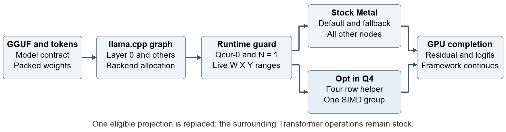

# 移动 GPU BitNet 推理技术方案

**Metal 概念验证与 Vulkan 跨平台适配计划**

面向 Tether 技术评估编写，供作者审阅的草案。证据截止日期为 16 November 2026，时区 Asia/Tokyo。

## 1 总体方案

我们提出优先使用 Metal 实现移动端 BitNet 推理，复用现有 llama.cpp 的计算图（graph）、加载器（loader）、内存规划器（memory planner）和 GPU backend。通过严格的 guard 检查，用一个矩阵向量 kernel 替换 Transformer 层中的一个投影；不支持的调用继续使用 stock 路径。同时，制定文件级实施计划，在选定的 Adreno 和 Mali 设备上扩展并验证 QVAC 已有的 Vulkan 支持。

实际交付内容是可复现的源码包、独立的 sample-I/O test harness，以及本技术方案。当前实现使用 Microsoft 公开 checkpoint 建立开发路径；团队预训练 checkpoint 的验收仍是另一项独立依赖。源码基线为 QVAC commit `2db8b046d555316019ae75d1be90484adc8b9330`。此前审阅的实现快照为 `bbf70e9cc70302534ff87b4f34d4ce52a9670baa`；本次修订新增单独标识的手机测试和 reference controls。相应源码与 binary 身份记录于 [E7]-[E9]。[E1][E2]

| 截至证据截止日的验证内容 | 结果与选型 |
|---|---|
| iPhone 14 Pro 上公开 2B 模型的 stock 推理 | 使用 A16 Metal 成功加载并生成 32 tokens，31/31 层完成 offload。功能执行通过；尚未忠实执行 Microsoft ActQuant。 |
| 公开模型语义 | 默认 baseline 缺少 ActQuant。新增 opt-in 已实现 source-derived F32 quantizer 并通过捕获数据的同输入检查；完整模型的冻结 reference 验收仍失败。 |
| 真实第 0 层计算图中的 Q4 specialization | 两组固定 history 均通过全部 32 次 Q 检查、抽样 residual 检查和完整 logits 的 parity 检查。保持 opt-in。 |
| 移动端性能 | Q4 每次独立 Q dispatch 节省约 6-7 us；没有观察到完整 decode 的收益。不能据此宣称模型加速。 |
| FFN 研究 | G 保留了已观测到的 stock 输出；F8 有性能证据，也保留数值和模型输出验收失败记录。二者都没有修复完整链路的 FP64 问题。 |

原始 4x2 PoC 现已通过新一轮 iPhone 真机 sample-I/O 验证：五个输入 case、三条路径，共检查 38,400 个值。最新两组 history 的真实图验收仍只属于 Q4。这些结果分别证明了声明范围内的输入算术和 stock 兼容性；二者都不能证明公开模型执行了 Microsoft activation 语义。[E3][E4][E7]

题目同时使用了“1-bit”和“1.58-bit”两种表述。我们实现的是三值 BitNet 权重，并不是二值 XOR/popcount kernel。如果题目严格要求只使用二值表示，就需要另一种权重表示以及相应的验收约定。

<!-- page -->
## 2 范围与作业要求覆盖

选中的运算是 `Qcur-0`，操作类型为 `GGML_OP_MUL_MAT`，使用 RoPE 之前的 `blk.0.attn_q.weight`。模型通过 llama.cpp 执行该层其余运算。自写 shader 对应层内的一项线性运算，并没有在一次 dispatch 中实现完整 Transformer block。当前 Q 接入仅允许第 0 层、单 token decode。[E4]



| 作业要求 | 对应章节 |
|---|---|
| 1 移动端低比特 kernel 设计 | 第 3 和 4 节 |
| 2 框架修改与跨平台适配 | 第 5 和 6 节 |
| 3 Profiling 方法与优化目标 | 第 9、10 和 12 节 |
| 4 框架 库与 SDK | 第 9 节 |
| 5 Kernel 优化策略 | 第 11 节 |
| 6 成功标准与 benchmark | 第 7 和 12 节 |
| 7 智能手机内存 功耗与计算限制 | 第 11 和 12 节 |
| 8 十天里程碑与检查点 | 第 13 节 |
| 9 风险与应对计划 | 第 14 节 |
| 10 假设与关键依赖 | 第 3 和 14 节 |
| 11 其他约束与提交内容 | 第 15 节 |

Metal 是已经实现的目标平台。主要交付链路依次为：模型语义、一项实体手机 kernel、独立 harness、受 guard 保护的真实图接入、公平的性能比较，以及可复现打包。FFN 融合分支是主要验收之外的可选探索。Android 执行、能耗测量和团队 checkpoint 验收仍属于计划工作。十天安排以作业 kickoff 为起点，并不表示所有已归档研究都发生在十天之内。要求的交付物包含源码脚本和 PDF，同时提供可编辑源稿供审阅。

<!-- page -->
## 3 模型与权重表示

公开兼容性实验使用 Microsoft `bitnet-b1.58-2B-4T`，源 revision 为 `04c3b9ad9361b824064a1f25ea60a8be9599b127`。其去重后的参数数量（unique parameters）为 2,412,820,480，其中 tied embedding 仅计数一次。转换后的文件包含 332 个张量：210 个 TQ2_0 矩阵、一个 F16 embedding，以及 121 个 F32 normalization 张量。它并不是团队的 checkpoint。[E2][R2]

| 属性 | 公开 checkpoint 的契约 |
|---|---|
| Transformer blocks 与宽度 | 30 blocks；hidden width 2560；FFN width 6912 |
| Attention | 20 query heads，5 KV heads，head width 128 |
| Tokenizer 与 activation | Vocabulary 128256；使用模型的 tokenizer/template；ReLU(gate)^2 * up |
| GGUF 字节数 | 1,203,563,808 bytes；约 1.121 GiB |
| SHA 256 | `52257df879ab4366d97228e7bda94a9a3c6a9065ec44e7879a8b87d54e568cd2` |

TQ2_0 用编码 {0,1,2} 表示三值权重（trits）{-1,0,+1}；fixture validator 会拒绝编码 3。一个 block 包含 256 个逻辑权重、64 个 packed bytes 和一个 FP16 scale。不计其他张量及 metadata，每个量化权重实际存储占用 66*8/256 = 2.0625 bits。三值符号集合的理想信息量为 log2(3)，约 1.585 bits。I2_S packing 不能与 TQ2_0 互换。[E2][R1]

对于输出行 r 和 block b，计算带 scale 的三值点积：

```text
y[r] = sum_b d[r,b] * sum_j (q[r,b,j] - 1) * x[256*b+j]
byte = 32*half + lane
j = 128*half + 32*plane + lane
q = (packed[byte] >> (2*plane)) & 3
```

其中 half 为 0..1，plane 为 0..3，lane 为 0..31。一个 byte 中的四个字段对应彼此分隔的逻辑 K 位置。FP64 reference 按该逻辑顺序独立解包；它评估的是输入的量化 W 与 F32 X，并不是原始未量化模型。

兼容性 patch 保留 AutoBitLinear 的直接 scale，避免对已经重建的三值权重再次量化，并选择显式的 ReLU-squared metadata。全部 210 个转换后的矩阵均已审计，没有 trit 或 FP16 scale 不匹配。这项存储审计不能证明 activation 或完整模型语义正确。[E2]

<!-- page -->
### 公开模型的 activation 契约与已确认偏差

Microsoft AutoBitLinear 在线性点积之前执行 per-token absmax INT8 quantize/dequantize。使用 F32 记法，其 reference 为：[R11][R12]

```text
s = 127 / max(max_j(abs(x[j])), 1e-5)
xq[j] = clamp(round(x[j] * s), -128, 127) / s
y = linear(xq, ternary_weight) * weight_scale
```

必须保留源码的 rounding、clipping、epsilon 和中间 dtype；BF16 与 F32 对照是独立实验。F32 张量也可能包含反量化后的 INT8 数值，因此不能只凭 dtype 判定量化缺失。本次源码追踪和捕获输入检查共同确认，默认 baseline 图将未量化 X 直接送入 TQ2_0 MUL_MAT。在局部对照中，原始带 scale 的 Q 权重与解包后的 TQ2_0 权重完全相同。[E8]

| 同一份捕获的 Q 输入 | Step 1 | Step 16 | Step 32 |
|---|---:|---:|---:|
| Stock 相对未量化 FP64 的超差行数 | 0/2560 | 0/2560 | 0/2560 |
| 官方 F32 ActQuant 改变的 X 数值 | 2559/2560 | 2560/2560 | 2559/2560 |
| Stock 相对 ActQuant FP64 的超差行数 | 2498/2560 | 2491/2560 | 2502/2560 |

这是已确认的语义偏差，在本对照中大于普通求和漂移。Kernel 对提供的 F32 X 仍然有效；保留的默认图缺少该公开 checkpoint 所要求的预处理；新增 opt-in 在下文单独验收。团队模型的 quantizer、scale 粒度、rounding 和 metadata 必须另行取得，不能推断团队 checkpoint 已通过验证。

<!-- page -->
### ActQuant 实现与剩余 reference 差距

独立实验分支新增了默认关闭的 `LLAMA_BITNET_ACTQUANT=1`。在每个 block 对应的 weighted normalization 后插入四个共享 quantizer：Q/K/V 输入、attention-output 输入、gate/up 输入和 down 输入。共 120 个节点覆盖 210 个 projections；tied lm_head 保持不变。独立 CPU 和 Metal `GGML_OP_ACT_QUANT` 实现保留既有 stock shader 的数学配置，只有新增 Metal library 使用已观测的 Safe/Precise 编译选项。[E10]

固定源码的 source-derived Torch F32 eager profile 实际以 `(1.0f / absmax) * 127.0f` 计算 scale。虽然数学等价，直接计算 `127.0f / absmax` 在部分行相差 1 ULP，并在首次真实图捕获中产生两个错误的 integer codes。失败记录和七数值反例均已保留。修复求值顺序后，扩展 fixtures 和全部捕获 quantizer 在各自实际输入上通过；这不代表所有 Torch compiler 或 dtype profile 都已验证。

| M2 Pro 新增数值证据 | 结果与范围 |
|---|---|
| 独立 CPU 与 Metal operator fixtures | 每个 backend 检查 20 cases、386,567 个数值；冻结容差与精确 recovered-code 检查通过。覆盖手算 ties、epsilon、dense 输入、真实 steps 1/16/32 和边界回归。 |
| 修复后的 teacher-forced 图 | 实际捕获 3,960 次 ActQuant、25,581,568 个数值；所有输出在同一捕获输入上与官方 F32 ActQuant 逐位一致。31/31 层完成 offload。 |
| Backend regression | MTL0 上 ACT_QUANT 16/16 和原 TQ2_0 MUL_MAT 59/59 通过。 |
| 完整模型 reference | 完整 teacher logits 与层输出仍超过冻结容差；strict exit 1 保留。局部 ActQuant 正确不等于完整模型数值等价。 |
| 小规模 128-target corpus | Metal ON PPL 19.127702、OFF 19.088221；source-derived F32 ON PPL 19.129530。仅为小规模 quality smoke，不宣称验收通过或质量改善。 |
| 此新增构建的 iPhone 真机 | TODO：sample-I/O、真实图执行、中间张量/logit 对照和 corpus 计分。此前手机结果使用尚未修复的 baseline。 |

关闭开关后的 logits 与已保存 baseline 逐位一致，带诊断捕获和普通执行的 logits 也一致。原 CPU/Metal 和完整 FFN 失败均未被覆盖。F32/BF16、per-token ActQuant、CPU 额外的 blockwise Q8_K packing、prefill/decode 算术与 KV 精度继续分别控制。下一步先定位 stock 模型剩余的 reference 漂移，再决定是否具备宣称忠实推理的证据。本次不新增 Mac 性能结果。

<!-- page -->
## 4 Kernel 设计与 sample 验证

对于 Q projection，W 有 2560 个输出行，K=2560。每行十个 66-byte blocks，因此每行 660 bytes，总计 1,689,600 bytes。X 和 Y 分别包含 2560 个连续的 F32 数值，各占 10,240 bytes。Kernel 不会将完整权重矩阵展开为 F32。

原始自写 PoC 在每个 lane/block 中加载八个 X 数值，解包 packed trits，应用各输出行自身的 block scale，并累加到四条独立的行部分和中。通过 SIMD reduction，每行写出一个值。X 在不同行之间复用。Reference 实现独立使用 FP64 累加。[E3]

| 路径 | 每个 SIMD group 的行数 | 每个 threadgroup 的组数 | Grid x | 来源归属 |
|---|---:|---:|---:|---|
| 实际 stock | 4 | 2 | 320 | QVAC 已有实现 |
| 原始 PoC | 4 | 2 | 320 | 独立编写的直接 unpack/dot |
| Q4 stock4x1 | 4 | 1 | 640 | 复用完整 stock helper 算术 |
| C8 研究版本 | 8 | 2 | 160 | 独立 packed-mask 算法；模型兼容性验收失败 |

Stock 和 Q4 总共都启动 640 个 SIMD groups 和 20,480 个 threads。Q4 将每个 threadgroup 的 SIMD group 数从两个改为一个，并没有增加每个 SIMD 内的 activation reuse。

在已测 Apple 设备上，以上配置均使用 32-lane SIMD groups。实际 launch dimensions 和 pipeline thread limits 会被检查。Q4 的历史函数名仍包含 `c8x2`；实际布局由 host geometry 和源码决定，不能仅根据名称判断。

### 可手算的输入与输出

Fixture 将零权重设置为编码 1，并使用变化的 block scales。第 0 行、第 0 个 block 中，byte 0x24 在列 [3,35,67,99] 提供编码 [0,1,2,0]。这些位置的 X 为 [1.25,4,2,-0.5]，scale 为 0.5，贡献为 0.625。第二个 block 在列 385 放置 +1 权重，scale 为 0.25、X=3，贡献为 0.75。[E3]

| 预期输出 | 数值与验证目的 |
|---|---|
| y[0] | 1.375；正负及零 trits，以及多个 scales |
| y[1] | 0；非零 trit 与零 block scale |
| y[2559] | -1.25；最后一行覆盖与负权重 |
| 其余 2557 个数值 | 0 |

其他 case 使用 dense seed 42，以及 decode steps 1、16、32 的真实 pre-RoPE 输入。检查全部 2560 行，包括有限值、canaries、输入不变和 GPU completion。总共有 2558 个零输出，其中包含 y[1]。

<!-- page -->
## 5 Metal 接入与源码改动

现有 loader、graph 和 backend 继续负责分配与调度。Opt-in 路线在 `ggml_metal_op_mul_mat_mv_encode` 内判断；每次符合条件的调用都解析实际 W/X/Y buffers 与 offsets。候选路线的 W/X/Y 绑定在 slots 0/1/2；stock 的 args/W/X/Y 使用 slots 0/1/2/3。两种 ABI 不能混用。以下 backend 文件名的共同前缀为 `ggml/src/ggml-metal/`。[E4]

| 修改的上游文件或模块 | 职责 |
|---|---|
| `conversion/base.py` | 公开 checkpoint 的直接 scale 重建；保留 legacy 处理 |
| `conversion/bitnet.py` | Offline ternary conversion 与 activation metadata |
| `src/models/bitnet.cpp` | 根据显式 metadata 选择已有 ReLU-squared FFN graph |
| `ggml/include/ggml-metal.h` | Replay 与 diagnostic 接口 |
| `ggml-metal-context.m` | Opt-in command-buffer 计时与 completion hooks |
| `ggml-metal-device.h` 和 `.m` | 外部 pipeline 声明、加载/缓存及 capability checks |
| `ggml-metal-ops.cpp` | Graph/shape guards、live bindings、dispatch、readback 与 stock fallback |

表格最后四行位于 GGML include 或 Metal backend 目录中。它们在该历史快照中合计对应八个修改的上游文件。新增 ActQuant 分支继续修改 GGML operation API/core、CPU 与 Metal backend 文件、`act_quant.metal`、graph placements 和 backend tests。新增 kernels、harnesses、iOS staging 和 analyzers 位于 `bitnet/`。QVAC 已经提供 TQ2_0 kernels 和 SwiftUI 示例，应将它们归属于已有基础设施。

Q guard 要求精确匹配 MUL_MAT node 与第 0 层 Q 权重、N=1、TQ2_0/F32/F32、已审计的 ne/nb、无 view、add=0、norm=0、兼容的 pipeline 与 launch、对齐的 live offsets，以及完整 byte-range bounds。仅当字节范围不重叠时，X 和 Y 才允许共享同一个 Metal buffer；W/Y 重叠会被拒绝。其他层、prefill、不匹配的契约以及 library/geometry 选择失败，均在自定义写入之前返回 stock。

最新真机对照证明了 missing-library 和 unsupported-geometry fallback。正常运行的 strides 会被检查；没有向真实 graph 注入畸形 stride。外部 pipeline cache 使用函数名作为 key，因此同名 symbol 的 library 切换及 missing-library 测试采用独立进程。

一项无条件生效的 residual-ADD binding 修正通过 tensor identity 选择另一个 operand。因此，“stock default”指默认选用 stock shader/dispatch，并不意味着 CPU backend 与原始 QVAC 字节一致。Compatibility、readback 与本轮 guard patches 可精确复现全部八个修改的上游文件。[E1][E4]

<!-- page -->
## 6 面向 Adreno 和 Mali 的 Vulkan 扩展

固定版本的 QVAC backend 已包含 TQ2_0 Vulkan matvec 支持。拟议的 Android 工作是审计并专门优化这套已有实现，而不是新建一套 runtime。Metal 上的结果不能证明 Android 上的正确性或速度。[R1][R6]

| `ggml/src/ggml-vulkan/` 下的现有文件 | 拟议的扩展或验证 |
|---|---|
| `ggml-vulkan.cpp` | TQ2_0 pipeline 选择、device/shape 变体和 fallback |
| `vulkan-shaders/mul_mat_vec_tq2_0.comp` | 同输入的三值 matvec，以及 row/workgroup 变体 |
| `vulkan-shaders/types.glsl` | 核对每个 packed block 的 256 个值及 FP16 scale ABI |
| `vulkan-shaders/vulkan-shaders-gen.cpp` | 只生成并注册必要的 specialization |
| `ggml-vulkan-push-constants.h` | 在原生 ABI 中保留 dimensions、strides 和 offsets |
| `ggml-vulkan-buffers.cpp` 和 `CMakeLists.txt` | allocation/staging 限制，以及可复现的 NDK/SPIR-V 构建 |

Android 的第一个里程碑是构建未经修改的 stock Vulkan 路径、列出目标设备的 feature 清单，并完成公开模型的功能测试。随后移植独立的 logical-K reference 和相同 sample cases。只有 stock 通过后，才在明确的 runtime guard 后启用特定 shape 的变体。将目标 shapes 加入 `tests/test-backend-ops.cpp`；若设备无法安全实现所需运算，则使用 CPU fallback。

查询 compute queue/timestamp 支持、subgroup 大小与操作、workgroup 限制、shared memory、descriptor/offset 对齐、memory heaps，以及窄位宽存储和 FP16 features。只有设备支持时才使用 subgroup reduction；否则采用保守的 workgroup/shared-memory reduction，并设置合法的 barriers。不能假设每个 Adreno 或 Mali 都使用 32-lane subgroup。Integer dot 指令、subgroup-size control 和 cooperative matrices 都是可选的设备专用变体。[R6]

对于 decode，优先研究 packed streaming 和 activation reuse；对于 prefill，使用 matrix tiling，在多个 token 之间复用权重。当前 Q PoC 只针对 decode，因此 prefill 保持 stock。应分别构建 specialization，不能把 GEMV 的执行几何强行套到 GEMM 上。

在 Android 上，host-visible memory 不一定具备 cache coherence。必须验证 staging、flush/invalidate 规则、descriptor bounds 和 synchronization。首先使用 F32 activation/accumulation；降低精度或引入 activation quantization 应作为独立的数值改动。在做跨厂商结论前，至少需要验证一种真实 Adreno 配置和一种真实 Mali 配置。设备与 driver 的可访问性是关键依赖，不是已完成的交付项。

<!-- page -->
## 7 正确性与验收协议

验证分为多个层级。冻结的实验数值规则保持不变：

```text
abs(actual - reference) <= 2e-4 + 2e-5 * abs(reference)
```

这是本项目的判据，不是作业题目规定的数值容差。每个阶段都必须声明 reference 和必须覆盖的范围。较小的 FP64 dot error 不能证明相对于 stock 的模型兼容性。[E3][E5]

| 验收项 Gate | Reference 与必需证据 |
|---|---|
| 存储与执行 | 正确的 packing/scales、hashes、全部输出写入、有限值、canaries、输入未改变，以及 GPU 工作完成 |
| parity_pass | 将同一份捕获的 W/X 交给指定路径；同时保留逐位差异和容差差异 |
| fp64_pass | 独立解包后的 FP64 dot，或明确声明范围的完整 FFN chain |
| model_output_pass | 声明的固定回放中，相对 stock 的 residuals/full logits；不能据此推断语言质量通过 |
| 综合结果 | 该模式的全部必需 gate 均须通过；缺失检查保持 null |

Exit 0 表示限定范围内通过或分析完成，1 表示观测到失败，2 表示证据缺失/无效；部分独立 utilities 使用 3 表示输入格式错误。必须查看对应工具的规则和保存的 strict verdict。设备编排 runner 也可能因 setup/transport 错误返回 1，因此必须查看 execution_pass、native completion、实际 app exit 和保存的 summary，再判断失败类型。Processing-only exit 0 不能覆盖严格数值失败。通过样例、非有限值、输出缺失和 hash 无效等对照用于检查 verifier 的退出语义。

从固定源码进行 clean build，不使用旧 dylib，对 actual stock、原始 PoC 和 Q4 统一运行手算样例、dense seed 42，以及真实 steps 1/16/32：38,400 个值全部通过，没有超差或非有限值行。Q4 在全部 12,800 个比较值上与 stock 逐位一致；原始 PoC 有 10,122 个 F32 值不同，但仍满足 FP64 容差。TQ2_0 backend regression 通过 59/59，筛选范围内失败与 unsupported case 均为零。这些是主机上的数值验证结果，不是 Mac 性能证据。[E3]

真实图验证检查全部 32 次符合条件的 Q 调用，而不是只抽查三个样本。每条路径读取一次 W，每步读取 X/Y，并在 steps 1/16/32 读取 residual output。独立 analyzer 在比较输出前，先拒绝 W/X hash 不一致的情况。Probe-off 与同进程重复运行必须保留全部 33 份完整 logits 向量。计时使用独立、无插桩的运行。

对于 FFN，必须区分两种 reference：基于每条路径实际输入的 FP64 down，以及完整的 FP64 gate/up -> ReLU-squared -> weighted RMSNorm -> down chain。Stock 和候选已有的完整链路失败继续记为失败；fusion parity 不能消除这些失败。798/880 是归一化 activation-error 诊断计数，不是 weighted-RMSNorm 输出的超差数。单凭严格判据失败，不能认定存在 bug 或语言质量不可接受。

### 数值规则的含义与边界

对于使用相同 W/X 且未改变的 PSO、复制和 packing 对照，逐位一致是合理要求。改变 reduction 后，FP32 合理地可能出现差异；保留逐位差异计数，同时独立应用声明的容差。对于顺序求和，gamma_K = K*u/(1-K*u)，其中 F32 u=2^-24，在 K=2560 时约为 1.5261e-4，在 K=6912 时约为 4.1216e-4。该系数乘以各项绝对值之和，并不是相对误差限额。消去、系数变换、FMA 和实际 reduction 拓扑都会影响误差界。这些估算用于解释敏感性，不替代冻结的经验判据。[E9]

ReLU(gate)^2*up 会放大投影误差；RMSNorm 会耦合各坐标。算子 FP64、完整链路 FP64、相对 stock 的输出和可信模型语义回答的是不同问题。在独立验证集上，预先声明产品 NLL/PPL、任务预算和文档级不确定性。V1 失败记录保留。

<!-- page -->
## 8 真机功能与数值结果

历史 smoke 测试使用 iPhone 14 Pro/A16、iOS 27.0.1、Xcode 27.2 和 iPhoneOS SDK 27.2。模型加载、生成、offload 和 KV placement 分别记录为独立结果。[E2]

| 模型与 framework | 加载 | 生成 Generation | Metal placement | KV placement |
|---|---|---|---|---|
| Patched 1.27B 回归 | Pass | 32 tokens; exit 0 | Apple A16; 25/25 offload | MTL0; 96.00 MiB |
| 公开 2B stock 基线 | Pass | 32 tokens; exit 0 | Apple A16; 31/31 offload | MTL0; 37.50 MiB |

传输后的 GGUF hash 已在手机端核对。公开 2B 的生成文本以 "A GPU, or Graphics Processing Unit, is a specialized hardware component..." 开始；完整原始输出保存在本地。这次 smoke 没有保存手机 token IDs，因此文本相同不等于 token-ID parity。不能将后续 replay 配置追溯套用为这次较早测试的 thread/batch 默认设置。

### 本轮 Q4 第零层验收

15 November 的 campaign 使用 iOS 27.2.1、Xcode 27.2、SDK 27.2，以及重新 clean build 的 framework。两组 history 均使用 27-token stock prefill、32 个固定 continuation IDs、context 512、batch/ubatch 128、六个 CPU threads、F16 K/V，并关闭 flash attention。只替换 Qcur-0。[E5]

| History | Custom encode 与 completion | S 加 Q4 的值数 | 超差或非有限值 | 最大 FP64 绝对误差 |
|---|---|---:|---|---:|
| Primary | 32 / 32 | 163,840 | 0 / 0 | 1.576802e-5 |
| Independent | 32 / 32 | 163,840 | 0 / 0 | 1.324259e-5 |

全部 Q 输出与 stock 逐位一致。抽查的 residuals、每份 full-logit 向量和 probe-off controls 也均逐位一致。声明范围内的 Q-only parity/FP64/model-output gates 通过，strict exit 为 0。这证明的是运行中 Transformer 层内的一个 projection，并不等于完整 Transformer 的 FP64 或模型质量验收。

### 原始自写 shader 的真机验证

精确的原始 `tq2_0_matvec_poc` 源码，SHA-256 为 `db8b1fd40120adee0bf2f8bc4db01ef7e7edf11692d285e143fa15f24c408b84`，已经重新编译并在 A16/iOS 27.2.1 上运行。Stock、原始 4x2 和 Q4 分别测试手算样例、dense seed 42 和真实 steps 1/16/32。全部 15 次 dispatch 完成；38,400 个输出完整写入且均为有限值，FP64 超差为零，输入/canaries 未变。原始 PoC 的最大绝对误差为 5.516948e-6。Q4 与 stock 逐位一致；原始算术虽有差异，但满足冻结的局部误差界。独立 CPU 重算及 binary/source 检查通过。[E7]

第二次运行对三个捕获输入使用官方 ActQuant 派生的 X，同样通过局部 FP64。这些是派生 fixtures，不是修复 ActQuant 图之后的捕获数据。它只补齐原始 shader 的手机 sample-I/O 验证；原始 PoC 的真实图和模型语义验收仍是独立事项。

### 可信源码 teacher forcing 与小规模质量 smoke

内存受控的 CPU reference 每次流式加载一个 decoder layer，执行从固定官方 Transformers 源码提取的算术。移除了 compilation/decorator 配套代码；这是 source-derived eager 执行，不是未经修改的完整 Transformers package 运行。使用原始 packed weights 和完全相同的 token IDs。BF16 与 F32 为独立对照；F32 无损提升 checkpoint 的 BF16 参数数值。同一 dtype 内唯一变量是 ActQuant ON/OFF。[E8]

| F32 teacher-forced 结果 | ActQuant ON | ActQuant OFF | 既有 QVAC Metal |
|---|---:|---:|---:|
| Token 18 的 computations 减 graphics logit | +0.094944 | -0.005909 | -0.005144 |
| Token 18 的 greedy 选择 | computations | graphics | graphics |
| 33 个检查点中与 QVAC 相同的 greedy 选择 | 31/33 | 33/33 | 33/33 |
| 相对 QVAC 的完整 logit RMSE | 0.251979 | 0.000724 | 0 |

在第 0 层第 16 步，QVAC 与两条 F32 reference 路径的 Q 输入逐位一致。ActQuant 在后续 cache/backend 差异出现前就改变了局部投影。完整 reference 使用无 KV 的 causal evaluation；QVAC 使用 F16 KV，因此不能将全部 full-logit 差异都归因于量化。同一 backend 的 ON/OFF 对照证明 quantizer 能引起排名变化。

标准来源的 WikiText-2 test 切片使用 BOS 加 128 个计分 targets。独立 FP64 logsumexp 计分得到 BF16 ON/OFF PPL 19.188825/19.098287，以及 F32 ON/OFF 19.129530/19.088566。这项很小的 test-split smoke 不代表完整质量 benchmark，也不能证明与预训练数据无重叠；OFF 分数略低不能成为省略规定 quantizer 的依据。原始 F32 计分和 raw logits 保留本地。在 iPhone 真机上，当前 stock 路径对相同 128 个 targets 的平均 NLL 为 2.949071，PPL 为 19.088221；全部 128 个同步步骤在 A16 上完成，31/31 offload，使用 F16 KV，没有 custom route。独立 CPU 重新计分与所示精度一致。相对 F32 OFF，全部 128 个 greedy 选择一致，完整 logit RMSE 为 0.000537；相对 ON，126/128 一致，RMSE 为 0.213242。这是已经完成的测量，不代表语义或产品质量通过。Native 与独立重算的分数记录于 [E8]。

此前 CPU/Metal 自由生成对照仍分别记录为 CPU generation 通过、Metal generation 通过、token parity 失败（strict exit 1）。第 18 个 token 的 computations-minus-graphics 分差为 +0.010254 和 -0.004967。CPU 按 block 的 Q8_K rounding 不同于 Microsoft per-token ActQuant；此前 rounding 与 KV 对照不能解决这一语义缺失。

<!-- page -->
## 9 Profiling 方法与开发工具栈

使用三种独立计时范围：CPU 选路与编码、GPU 完成后的 command-buffer elapsed time，以及同步后的应用 wall time。对于独立算子，一个 command buffer 只包含一次目标 dispatch；仅在完成后读取 `gpuEndTime-gpuStartTime`，并将秒换算为微秒。这个指标不是纯 shader cycles。[R4]

每个正式算子对照使用完全相同且驻留的 W/X，每路预热 30 次，每轮交替执行 201 对 AB/BA，共三轮。保存 p50、p95、逐对 candidate-minus-stock 的中位差、胜出次数、执行顺序分组和按时间顺序划分的数据块。A/A 用于校准，不能从候选样本中扣除。Nominal 端点和持续负载 cohort 分开报告。正式计时时关闭 capture、readback 和 diagnostics。

| 工具栈 Stack | 用途与状态 |
|---|---|
| QVAC llama.cpp 和 GGML | 固定版本的 graph、loader、CPU/Metal/Vulkan backends；已实现 |
| Git CMake Clang 和 Python 3.9 或更新版本 | 可复现构建与 analyzers；完整 Q 分析使用 NumPy |
| 独立转换环境 | Python 3.11、PyTorch、Transformers、tokenizers、safetensors、NumPy 和固定的仓库内 gguf-py；版本见 BUILD_AND_RUN.md |
| 完整 Xcode 和 Metal compiler | Metal/AIR/metallib 与 iPhoneOS arm64 framework；实测 Xcode 27.2 |
| Apple SDK frameworks 和 devicectl | Metal、Foundation、Accelerate、UIKit 和 SwiftUI；签名、部署和固定 token 回放 |
| Xcode GPU Capture 和 Instruments | Pipeline/launch/dependency 核对、Metal System Trace 与 CPU/memory profiling |
| Android SDK NDK CMake 和 adb | 拟议的 Android arm64 打包与部署 |
| Vulkan loader headers shaderc 或 glslang 和 SPIRV Tools | 拟议的 shader 构建、验证及 feature-specific pipelines |
| APA AGI 和 Perfetto | 拟议的受支持 Android 设备上的 system/frame profiling；APA 是当前推荐的 system 选项 |
| Qualcomm Snapdragon Profiler 和 Arm Performance Studio | 拟议的厂商专用 counters；Mali Offline Compiler 用于静态估计 |

历史转换环境使用 torch 2.11.0、transformers 5.10.0、NumPy 2.2.6、tokenizers 0.22.2 和 safetensors 0.8.0。该 transformers 版本已被 yanked；只应在独立复现环境中保留它，并另行验证替代版本。合成 kernel 测试不需要这些包。

Xcode counters 采集可能使各 pass 串行执行，因此 profile/capture 与正式计时必须分开。AIR 可以确认中间代码的变化，不能证明硬件 stall、带宽或 occupancy。当前项目的 runtime counters 仍为 unavailable。Counter 采集失败记录的是工具/设备限制，不是 memory、ALU 或 occupancy 瓶颈的证据。应补充匹配的 shape/launch 扫描和受控 load/compute microbenchmarks。同 fixture 的 guard-only 对照使用实际 stock PSO，记录于 [E9]。[R5]

Android 工具需要兼容的 OS/driver 权限和可调试应用；APA 当前处于 public beta。必须在选定设备上验证实际工具版本。在支持时使用 AGI/Perfetto 或厂商工具。部署说明和工具可用性不等于已测得的 Android 结果。[R7][R9][R10]

<!-- page -->
## 10 iPhone 实测性能

本轮 Q4 算子测试使用已验收的 primary step-16 fixture。下表单位为微秒，指标为单 dispatch 的 GPU command-buffer elapsed time。全部样本均保留；每个 thermal cohort 含三轮 stock/Q4 直接配对，每轮 201 对。[E5]

| Cohort 与轮次 | Stock p50 / p95 us | Q4 p50 / p95 us | 逐对 Q4 减 S 的中位差 us | Q4 胜出对数 |
|---|---|---|---:|---:|
| Nominal 1 | 224.542 / 228.500 | 218.500 / 222.000 | -6.250 | 198/201 |
| Nominal 2 | 224.542 / 228.333 | 218.375 / 222.625 | -6.042 | 195/201 |
| Nominal 3 | 224.125 / 228.500 | 218.125 / 221.000 | -6.000 | 198/201 |
| Serious 1 | 226.000 / 230.000 | 219.375 / 223.875 | -6.208 | 194/201 |
| Serious 2 | 226.125 / 229.875 | 219.167 / 223.042 | -7.000 | 198/201 |
| Serious 3 | 224.875 / 229.125 | 218.542 / 222.750 | -6.083 | 197/201 |

逐对相对降幅的中位数为 2.681%-3.112%。所有执行顺序分组和时间四分位组的直接配对中位差均支持 Q4。A/A 配对中位差范围为 -0.333 到 +0.292 us。热状态观测是端点，不是连续的时钟或温度记录；nominal 不能证明设备处于冷机或固定频率状态。这里比较的是完整算子路径，而不是仅比较 threadgroup 大小。

整模型范围测量 32 个固定 decode tokens；清空 KV、恢复相同 prefix 的操作均在计时区间外完成。计时包含 CPU encoding、GPU execution 和 completion。两次 campaign 都只使用 primary history，比较 A/A 和 stock/Q4，执行三轮，每个对照每轮 21 对：每次 campaign 共 126 对和 8,064 条 token records。

| Campaign 与轮次 | S p50 ms | Q4 p50 ms | 逐对 Q4 减 S 的中位差 ms |
|---|---:|---:|---:|
| First 1 / 2 / 3 | 1523.294 / 1519.479 / 1672.692 | 1523.119 / 1528.410 / 1683.458 | +1.510 / +8.954 / +9.811 |
| Sustained 1 / 2 / 3 | 1838.651 / 2000.696 / 2418.593 | 1847.512 / 2018.455 / 2421.630 | +7.261 / +8.099 / +0.339 |

没有观察到整段 decode 收益。持续负载最后一轮的差值与执行顺序、时间趋势及 A/A 波动重叠，因此尚未建立普遍、固定的性能损失结论。每轮完整 p95 和顺序统计保存在 derived tables 中。不能将孤立算子的节省量直接相乘，当成模型加速。

<!-- page -->
### FFN 融合性能探索

这些新增 FFN 分支在选定的 Q-projection PoC 之外，探索减少 dispatch 和中间数据访问。以下结果来自历史 iPhone 14 Pro/A16 真机实测，使用 ActQuant 修复之前的公开 2B compatibility 路径。它们不能证明 Microsoft W1.58A8 语义或语言质量。Gate/up 将 2560 个输入扩展为 6912 个数值；激活为 ReLU(gate)^2*up。[E6]

| 路线 | 实现与图覆盖范围 | 正确性与选型 |
|---|---|---|
| G | 使用 stock 四行算术，在一次 dual projection 中完成 gate/up，再单独执行严格的 activation；weighted RMSNorm/down 保持 stock。覆盖全部 30 blocks。 | 两组 history 的全部 33 份 logits 均与 stock 逐位一致。更广范围的 FFN FP64/层输出验收仍未验证。保留为保守的研究对照。 |
| K | G dual projection 后，合并 activation/weighted RMSNorm；down 保持 stock。实际覆盖 28 blocks。 | 同输入 old-K0 parity 与新增阶段的 FP64 通过；完整 FFN FP64 和相对 stock 的 logits 失败。保持实验状态。 |
| F8 | 一次 dispatch 完成 C8x2 gate/up 与 activation；weighted RMSNorm/down 保持 stock。覆盖全部 30 blocks。 | 可观测的 fusion/split-C8 parity 通过；完整 FFN FP64 和相对 stock 的 model-output 失败继续保留。保留性能证据，不作为已验收的模型替换版本。 |

独立完整 FFN harness 中，stock 编码 7 次 dispatch，G 为 4 次，K/F8 为 3 次；这些不是完整模型图的 dispatch 计数。符合条件的真实图 dispatch 均完成 GPU 执行。K 在第 2 层因 encoder boundaries 安全回退，在第 29 层因 aliases 安全回退。

### 较早的直接 stock 对照

完整 FFN GPU 计时在同一个 command-buffer 边界内包含 weighted RMSNorm 和 stock down：预热 30 次，三轮，每轮 201 对交替执行。另一项同步后的 32-token wall-time 测量使用两组 history、三轮、每项对照每轮 21 对，并配有 A/A 校准。KV reset/prefix restoration 不计时；正常 CPU encoding、execution 和 completion 均计入。

| 路线 | 完整 FFN GPU 相对 stock 的配对降幅 | 32-token wall 相对 stock 的配对降幅 | Decode 胜出对数 |
|---|---|---|---|
| G | 4.814%-5.070% | 1.062%-2.664% | 121/126 |
| K | 5.440%-5.675% | 1.263%-2.724% | 122/126 |
| F8 | 10.018%-10.145% | 4.333%-5.121% | 126/126 |

这些范围来自各轮逐对相对降幅的中位数，不是混池后的延迟，也不是两路中位耗时的比值。热状态与时间漂移均保留；K 有一轮 p95 更差。尚未建立普遍的尾延迟收益，也没有 G 与 K 之间的直接模型级排名。

### 后续 G 与 F8 的直接对照及选型

另一次较晚的 campaign 在两组 history 上直接配对 G/F8：每组 history 三轮、每轮 21 对，并配有 G/G 校准。F8 胜出 123/126 对；配对 wall-time 降幅中位数为 1.961%-3.568%，每 32 tokens 的 F8-minus-G 配对差中位数范围为 -32.744 到 -105.156 ms。该较晚 campaign 没有正式 stock 对照。它的数值不与较早 stock 对照合并；算术和布局同时改变，也不能将差异全部归因于融合。

F8 的实测吞吐收益信号最强，但未通过严格数值及 model-output 验收。G 的 stock-output 兼容性证据更强；尚未建立 K 相对 G 的直接模型级优势。这些分支保留为可选研究，stock 默认路径以及 PoC/Q4 验收另列。完整 p50/p95、失败项和实验身份索引见 `bitnet/analysis/ffn-performance-exploration/`。[E6]

<!-- page -->
### 完整 guard 后调用同一个 stock pipeline

新一轮同构建 A16 对照使用 S（实际 stock）、QB（完整 Q4 guard，随后保持 stock dispatch 不变）和 Q4。在每个目标 step，S/QB 共享实际 stock PSO、原生 120-byte arguments、六个 slot 的 bindings/live offsets、grid 320 和 threads [32,2,1]。QB 通过 32/32 次 guard，custom Q dispatch 为零，并且全部 32 份捕获 Q 向量、抽样 residuals 和全部 33 份 logits 均逐位一致。Probe-off 重复运行一致；prefill 的 custom/guard 命中均为零。本次 guard-only 测试未重新计算 FP64，因此该字段保持 null，完整 V1 exit 为 2。首次诊断运行的 allowlist abort 已保留；修复后重新运行，通过限定范围内的 execution/parity 检查。[E9]

一项简短的稳态 32-token wall-time 筛查采用一次 warmup、三轮、每项对照每轮七个交替执行的 pairs。清空 KV 和恢复共同 prefix 在计时之外完成，关闭 capture/readback/trace。它不是 201-pair 独立 GPU 测试协议。

| 轮次 | AA 配对 B 减 A ms | QB 减 S ms | Q4 减 S ms |
|---|---:|---:|---:|
| 1 | +1.331583 | +12.587541 | +14.572291 |
| 2 | +2.216500 | +13.328583 | +9.658000 |
| 3 | +0.665458 | +10.020126 | +9.710167 |

虽然执行相同的 stock shaders，QB 在三轮配对中位数及两个执行顺序子组中均更慢。这支持额外 guard/plan 路径对本次筛查结果有所贡献。每轮七对样本、nominal 到 serious 的热漂移，以及第二轮 A/A 按顺序分组的较大波动，限制了估计精度。没有分别采样 CPU guard/encode 时间和 GPU elapsed time；尚未建立普遍固定的成本，也不能归为纯 CPU 或 GPU 原因。Q4-minus-QB 仍同时包含 encoding、launch 和 scheduling 变化。在派生分析中保留 p95、胜出数和时间/顺序统计，不将本 campaign 与此前计时混池。


<!-- page -->
## 11 优化策略与移动设备约束

每次只优化一种机制，提出可证伪的假设，并保持对照的计算范围一致。需要模型兼容性时，保留完整的 stock 逐行算术。所选 Q4 是一种保守的 specialization；不将 M2 Pro 的性能结论移用到 A16。[E4][E5]

| 机制 | 预期收益与必要对照 |
|---|---|
| Packed streaming 与 activation reuse | 在不展开完整权重的前提下减少重复的 X 计算；使用相同 W/X 对照，并检查实际生成的加载操作 |
| Threadgroup 与输出行映射 | 平衡并行 group、数据复用和存活的中间值；检查每一行、pipeline 限制及执行顺序效应 |
| 系数与 reduction 拓扑 | 减少解包和点积工作；分别检查 FP64 误差与 stock 差异，因为 FP32 算术次序会改变误差传播 |
| 合法的局部融合 | 仅当图的消费者、别名关系和编码边界允许时，减少 dispatch 与中间数据访问 |
| Prefill tiling | 在多个 token 列之间复用权重；作为独立的 GEMM 路径，不能直接从 decode 布局外推 |
| CPU 计划与调度 | 先比较“完整 guard 检查后调用同一 stock PSO”的对照，再将模型级损失归因于 shader |

FFN 性能探索统一整理在第 10 节。融合必须保留共享 X、每层自己的 W/scales、消费者关系及合法依赖。如果没有有效的跨 dispatch 同步，一个 threadgroup 不能读取另一个 group 尚未完成的结果。完整 FFN 对照包含 weighted RMSNorm 和 down。

### 根据实测关键路径占比选择目标

Qcur-0 是一个 buffer 已审计、尺寸为 2560x2560 的有限验证入口，不是已证实的模型瓶颈。Tied F16 embedding/output 为 128256*2560*2 = 656,670,720 bytes（656.67072 MB；626.25 MiB），占 GGUF 文件的 54.560524%。真实图在 `result_output` MUL_MAT 中使用它，输入为 F32 X，输出为 logits。存储占比不能证明运行带宽或延迟占比。在决定大范围优化优先级之前，应测量 output projection、attention、量化投影、normalization 和 CPU 间隙。[E9]

若 f 是实测关键路径占比，r 是局部耗时降低比例，则模型加速比为 1/(1-f*r)。假设局部降低 3%，在 f=1% 或 10% 时，预计整模型耗时仅降低 0.03% 或 0.30%。这些占比只是示例，并非本项目实测。只替换单层 Q，覆盖范围天然有限。

Q4 改变 group 分组，同时保留每个 SIMD 的四行和相同的 SIMD 总数。其自定义 wrapper/ABI 和编译上下文也不同于实际 stock。更小的 threadgroup 可能改变调度，但 activation reuse、register pressure 和 occupancy 尚未实测。Same-stock guard 对照用于分离新增检查路径；要推广结论，仍需在不同 shape 和真实权重流上进行 launch 扫描。

A16 的共享资源和持续运行的热预算有限。应保持 packed weights 常驻，使用大小受控的 scratch buffers、异步初始化和明确的生命周期管理。完整 F32 Q 矩阵需要 26,214,400 bytes，而 packed 表示为 1,689,600 bytes。这是存储量对比，不是实测带宽加速。1.121 GiB 的 GGUF 文件也不等于进程内存占用：embeddings、KV、scratch、可执行文件和驱动分配同样需要计入。

根据实测内存预算调整 context 和 batch。优先采用连续的 packed 读取，以及合法 threadgroup 内的数据复用，避免增加每 token 的复制。额外的 lookup table、重排或系数准备，都必须计入候选的成本。局部数组大小或 AIR 不能证实运行时 spill 或 occupancy。

<!-- page -->
低功耗运行应在保持正确性的前提下，减少内存访问、不必要的 CPU 轮询和超出热预算的负载。iOS 使用 thermal notifications 与自适应策略，Android 使用受支持的 ADPF hints/headroom；这些机制都不保证固定时钟或能耗下降。Energy 必须单独测量。[R8]

## 12 成功标准与评测基准

数值阈值保持冻结。下表性能目标是拟定的工程目标，不是题目给定的要求，也不是已经取得的结果。Stock 路径仍是功能回退和算术 reference；它缺少公开模型 ActQuant，因此不能作为语义 oracle。

| 领域 | 拟定验收标准或目标 | 截止时的状态 |
|---|---|---|
| 功能推理 | 加载并生成，确认 mobile GPU offload；没有意外 fallback 或崩溃 | 公开 2B 在 A16 上通过；团队模型与 Android 待验证 |
| 算子正确性 | 全部必需输出均为有限值、完整写入并满足冻结 FP64 容差；另行报告 stock 差异 | 原始 PoC 的主机/真机样例与本轮手机 Q4 通过 |
| 模型语义 | 转换、ActQuant、选定中间张量及 teacher-forced logits 与可信源码对齐 | Opt-in 同输入 quantizer 通过；完整模型 reference 与手机验收仍待完成 |
| 语言质量 | 预先声明 held-out NLL/PPL 和任务预算，匹配 tokenizer，并记录不确定性 | 已测 128-token test-split smoke；产品验收未验证 |
| 层兼容性 | 两组 history 的必需 Q/residual/logit 检查通过；保留严格判据下的失败 | Q4 在声明的 layer-0 范围通过；更广的质量评测未测 |
| 算子优化 | 与实际 stock 直接配对，3 轮的耗时降低中位数目标至少 5%，并检查执行顺序 | Q4 实测 2.68%-3.11%，低于这一后续目标 |
| 模型级候选晋升 | 直接测得稳态 decode 改善，且能与 A/A 波动和漂移区分；保留 p95 | 未观察到 Q4 整段 decode 收益 |
| 内存与持续运行 | 无 OOM；测量峰值 footprint/scratch；至少进行 10-minute 受控热状态研究 | 峰值与受控持续运行协议待完成 |
| 功耗 | 使用受支持的 energy 信号和相同工作量；在不损失正确性和延迟的前提下，目标 J/token 至少降低 5% | 未测 |

使用 benchmark matrix，而不是只给出一个宣传性的 tok/s 数字：手算与稠密输入；真实 steps 1/16/32；完整 32-call replay；两组不同 history；decode 与 prefill；nominal 与持续负载分组。计划测试的 prefill 长度为 32、128 和 256 tokens，并在 context 512 下进行 32-token decode。只有在验证内存和位置编码限制后，才增加其他 context。保留精确 token IDs、chat template、threads、batch/ubatch、KV dtype 和 flash-attention 配置。

模型加载时间与 time to first token 分开报告。测量 prefill latency/tok/s、稳态 decode 墙钟延迟/tok/s、逐 token 的 p50/p95、进程/GPU 峰值分配及实际 offload。独立 GPU 计时、完整 FFN 区间、完整 Transformer 层和应用 decode，是不同的测量范围。插桩后的层切片可能改变调度，应标明其诊断范围。

功耗测试需要受支持的平台信号，或与同一工作负载同步的外部仪器，并明确测量边界。区分整机 energy 与估计的 GPU-only energy，控制充电、屏幕和热状态，并报告 idle/control 的不确定性。仅凭电池百分比或 Instruments energy impact，不能得到 joules/token。不能从算术准确性推断模型质量通过；独立 held-out evaluation 需要与团队另行约定。

<!-- page -->
## 13 十天分阶段计划

本计划以 kickoff 为起点。已有研究提供可复用证据，但这里并不将其重构成实际发生过的十天工作日志。Metal 是需要实际执行的 PoC 路线；Android 真机工作取决于硬件与驱动访问条件。

| Day | 里程碑 | 可审阅交付物与检查点 |
|---:|---|---|
| 1 | 冻结模型与 baseline | 源码/模型哈希、tokenizer/template、scale 与 activation 契约、目标设备能力清单 |
| 2 | 建立 stock 推理基线 | 清洁构建 backend；分别记录 CPU 和真机的加载、生成与 offload 结果 |
| 3 | 建立独立 oracle | 可手算样例、固定 seed 的稠密样例、logical-K FP64 reference、strict-exit 控制测试 |
| 4 | 实现 PoC | 原始 Metal matvec、完整输出覆盖、边界/canary 检查和 sample-I/O 结果 |
| 5 | 接入一个真实节点 | Opt-in Qcur-0、实时 buffer 绑定、完整固定序列回放与 stock 回退 |
| 6 | Profile 并选择一种机制 | 可取得的 Capture/AIR/counter 证据；一个假设与受控短轮 A/B |
| 7 | 验证手机候选 | 精确 shader 的 sample-I/O，以及两组 history 的全部调用图检查；数值失败时不晋升为性能交付候选 |
| 8 | 评估性能与约束 | 直接 A/A 和 stock/candidate 配对、prefill/decode、热状态与内存报告 |
| 9 | 收敛风险与可移植性设计 | Adreno/Mali feature/file matrix；仅在设备可用时执行移植；保留未决证据 |
| 10 | 冻结并准备答辩 | 清洁源码包、已审阅 PDF、复现入口、限制说明与面试代码讲解 |

可选的 FFN/fusion 探索安排在主要 kernel 验收之后，不得延误语义对齐、sample-I/O 验证、真实图检查或可复现打包。每日 checkpoint 记录源码/模型/输入哈希、实际退出码、数值标志、性能范围、当前阻塞及下一项能区分假设的实验。状态分为实测通过、实测失败或未验证。原始证据保持不可变，派生汇总进行版本管理。

某个候选失败后，应保留失败结果，并继续可独立推进的工作，例如 reference 检查、构建可移植性或文档。不要在没有区分性假设的情况下，用剩余时间不断生成相似变体。签名或真机访问受阻时，保存最小 reproducer，同时继续 CPU 与源码任务。

实验 ActQuant 已通过同输入检查。当前优先对齐剩余 stock 模型精度与误差传播，比较可信源码中间张量和 teacher-forced logits，再验收新增手机构建。即使 quantizer 正确，细小的上游差异仍可能跨越 INT8 rounding 边界。后续性能必须计入 quantizer 准备成本。[E9] 中的 same-stock guard 对照支持框架归因；选择下一个性能目标前，仍需按算子类别测量关键路径。

<!-- page -->
## 14 风险假设与应对方案

| 风险或依赖 | 可观察后果 | 缓解措施与应对方案 |
|---|---|---|
| 默认 baseline 缺少 ActQuant；opt-in 模型对齐尚未完成 | 尚未建立忠实的 W1.58A8 执行 | 保留局部 quantizer 检查；候选晋升前解决 reference 精度/误差传播并验收手机 |
| 团队 checkpoint 与公开模型不同 | scale、activation、tokenizer 或图语义错误 | 先冻结 metadata/tensor 契约；审计转换；公开模型与团队模型分别验收 |
| 将题目按字面解释为 binary | 三值实现可能被判定超出范围 | 明确约定 1.58-bit 指三值 BitNet；仅在确有要求时设计 binary specialization |
| FP32 算术误差传播 | 局部点积通过，但层输出/logits 失败 | 独立 FP64 与 stock-relative 双重检查；保留 stock 算术及全部失败结果 |
| 完整 FFN 的 FP64 失败 | 将 fusion parity 误认为数值修复 | 分别比较 actual-input down 与完整链路；保留 strict exit 1 |
| 融合的别名或依赖不匹配 | 数据竞争或损坏 | 检查 consumer/edge/buffer/encoding guard；在自定义写入前拒绝；回退 stock |
| 热漂移与 profiling 扰动 | 虚假的加速或错误的瓶颈归因 | 平衡配对、A/A、时间/顺序分组；capture 与正式计时分开 |
| 工具链签名或 profile 过期 | 构建/安装受阻 | 新 manifest、用户管理的凭据、Trust/Developer Mode 操作；继续主机侧工作 |
| Android feature 不支持或缺少手机 | 无法形成有依据的跨平台结果 | 查询 feature；采用可移植的 F32/reduction 回退；硬件相关结果标为未验证 |

我们假设能够合法访问团队的权重、tokenizer 和推理规格，具备可用的 Apple 签名环境、物理目标设备，以及使用相关 profiling 工具的权限。公开模型 compatibility patch 不代表已经认可所有 BitNet checkpoint。Microsoft 已公布的公开 activation 契约是真实的模型依赖，不能假设未经过 quantize/dequantize 的 F32 activation 与之等价。团队模型要求，包括可接受的算术容差和质量预算，必须另行确认。

当前完整 FFN 的失败是具体存在的。新的 correction-placement Down 对照选取每路 96 个输出；stock、stock-wrapper 和候选均保留相同的 12 个失败位置。候选改变了 48 行，使最差 error/tolerance 从 1.566268 增加到 1.829765。Native 与独立 strict 退出码仍为 1；没有开展全矩阵扩展，也没有宣称数值修复。[E5]

全部安全与数值验收仍保持启用。后续应用质量标准需要单独的 reference 和依据，不能覆盖这些冻结的实验失败。公开模型语义修复、团队 checkpoint、Android、代表性质量评测和 energy 缺口仍是明确的交付限制。原始 PoC 独立真机验证的缺口已补齐，但不能因此认定已完成其真实图接入。

<!-- page -->
## 15 源码交付与可复现性

私有源码仓库包含固定的 QVAC 源码、兼容性修改、原始 PoC、复用 stock 的 Q4、guarded integration、iOS runners、独立 references 和派生分析。不包含模型权重、原始 tensor/logits、原始计时样本、签名 app/framework 或凭据。原始证据保留在本地 Mac。[E1]

| 源码位置 | 审阅用途 |
|---|---|
| `bitnet/validation/` | 原始 matvec、Q4 specialization、known/dense/real fixtures 与独立 FP64 |
| `bitnet/shaders/` | 手机候选 shader，包括复用 stock 的版本与研究变体 |
| `bitnet/ios/` | 清洁 arm64 framework/app 构建，以及 fixed-token/device runner |
| `bitnet/analysis-tools/` | Complete-Q、paired-timing 和 selected-Down CPU analyzers |
| `bitnet/patches/` | 基础 compatibility/backend patch，以及默认关闭的附加 readback patch |
| `bitnet/analysis/2026-11-15-iphone-q4/` | 整理后的逐轮汇总，以及仅含摘要哈希的本地证据索引 |
| `bitnet/analysis/review-2026-11-15/` | 语义对照、原始 shader 真机验证、guard 对照和优先级分析 |

由于可用 GitHub 凭据的 scope 限制，发布的源码导入省略了 63 个 upstream CI workflow 文件；runtime、本地 build/test 源码均保留，准确的排除清单已有记录。所含 patches 已在本仓库应用。清洁独立 baseline 对照仍需要单独的 pristine upstream checkout。

### 最小数值重建

```sh
export DEVELOPER_DIR=/Applications/Xcode.app/Contents/Developer
python3 bitnet/validation/bootstrap.py \
  --qvac-repo /path/to/existing-qvac-repository \
  --work-root /path/to/fresh-clean-validation
```

这个 model-free 入口构建 pristine pinned backend，运行两个合成样例及 TQ2_0 regression。指定真实样例时，需要单独的本地 capture，不能静默降级为仅测试合成样例。它是数值测试，不是 Mac 性能 benchmark。

### 真机复现

```sh
python3 bitnet/ios/build.py --team "$APPLE_TEAM_ID" \
  --bundle-id "$BUNDLE_ID" --allow-provisioning-updates \
  --output "$ARTIFACTS/build"
python3 bitnet/ios/run.py --build-dir "$ARTIFACTS/build" \
  --device "$IPHONE_DEVICE_ID" --model "$BITNET_2B_GGUF" \
  --mode graph-verify --routes S,Q4 --layers 0 --install \
  --history-dir bitnet/ios/histories/primary --q-readback \
  --output "$ARTIFACTS/primary-on"
```

所有输出目录必须是新目录；在本地设置 artifact/model 的绝对路径。先运行配套的 probe-off 和 independent-history 对照，再执行 CPU analyzer，之后才开始正式计时。完整步骤、准确范围及预期的 Down strict 失败见 `bitnet/docs/IPHONE_Q4_COMPLETE_2026-11-15.md`。原始 shader 使用单独的 `poc-verify` fixture/run 入口。可信源码 CPU 对照和小规模手机 PPL smoke 也有各自入口；完整命令与范围见 review analysis 目录。这些运行不会静默地为推理补上缺失的 ActQuant。

<!-- page -->
## 16 证据索引与参考资料

下列路径按说明分别相对于 workspace 或源码包。ID 用于区分本地实测证据与公开设计资料。证据截止日期为 2026 年 11 月 16 日；可变动的厂商文档也在该截止日期进行了核查。

### 本地证据

- [E1] 源码快照 bbf70e9；`bitnet/provenance/BASELINE.json`、`SOURCE_MANIFEST.json`、`bitnet/docs/CHANGES_FROM_QVAC.md`。[私有源码仓库](https://github.com/moonofrainday/bitnet-metal-submission)。
- [E2] Workspace 中的 `outputs/experiments/2026-11-07_133437-public-2b-compat/` 保存转换/模型身份和 CPU/Metal strict comparison；`2026-11-07_152028-iphone-public-2b/` 保存 patched 1.27B 和公开 2B 的 phone smoke。
- [E3] 源码包中的 `bitnet/validation/analysis/` 与 workspace 中的 `outputs/experiments/2026-11-15_170005+0900-clean-poc-stock4x1/`；保存清洁源码/构建、known/dense/real 算子证据。
- [E4] 源码包中的 `bitnet/docs/SOURCE_WALKTHROUGH.md`；原始 `bitnet/validation/shaders/matvec.metal`；Q4 `bitnet/shaders/stock4x1.metal`；以及已审阅快照中的 backend `ggml/src/ggml-metal/ggml-metal-ops.cpp`。
- [E5] Workspace 中的 `outputs/experiments/2026-11-15_182149+0900-iphone-q4-complete/`；源码包中的 `bitnet/docs/IPHONE_Q4_COMPLETE_2026-11-15.md` 和 `bitnet/analysis/2026-11-15-iphone-q4/`。包含无效的早期 capture、strict 通过结果、计时与 Down 负结果对照。
- [E6] 源码包中的 `bitnet/analysis/ffn-performance-exploration/`、`bitnet/docs/IPHONE_RESULTS.md` 和 `VALIDATION.md`；workspace 中的 `2026-11-12_202159+0900-iphone-candidate-sequence/` 保存 stock/G/K/F8 对照，`2026-11-13_080244+0900-iphone-independent-gf8/` 保存后续 G/F8 直接对照。两者均为历史 campaign，配置与失败记录分别保留，并非在最新 binary 中的重跑。
- [E7] Workspace 中的 `outputs/experiments/2026-11-15-review-221448/`；原始 shader 真机运行 `runs/original-poc/` 和 `runs/original-poc-actquant-derived/`、独立复算及 source/binary 摘要。自写 PoC commit 为 `7d680ad`；签名构建 metadata 关联实际 binaries。
- [E8] Workspace 中的 `outputs/review-response-2026-11-15/semantics/`；精确源码 CPU 脚本、`SEMANTICS.md`、`reference-full/`、`reference-full-f32/`、作为正式计分依据的 `SCORING-FP64.json` 和 `reference-ggml-f32-comparison-v2/`。手机 smoke 和 raw logits 保留于 [E7]。整理后的源码/分析位于 `bitnet/analysis/review-2026-11-15/`。
- [E9] Workspace [E7] 中的 guard 实验；源码包中的 `bitnet/docs/PHONE_GUARD_CONTROL_2026-11-15.md`；源码与派生的 `PROFILE_NUMERICS.md` 说明归因边界，并保留第一次无效诊断运行。

- [E10] Workspace `outputs/experiments/actquant-2026-11-15_231612+0900/`；保留 direct-scale 失败、修复后的 CPU/Metal fixtures、teacher/corpus 运行和 sequential-prefill 对照。Package `bitnet/actquant/` 与 `bitnet/analysis/actquant-2026-11-16/` 包含代码和分析；原始证据留本地。新增 iPhone 结果为 TODO。

<!-- page -->
### 公开原始资料

- [R1] [QVAC pinned Metal source](https://github.com/tetherto/qvac-fabric-llm.cpp/blob/2db8b046d555316019ae75d1be90484adc8b9330/ggml/src/ggml-metal/kernels/mul_mv.metal)。既有 low-bit 算术和源码归属基线。
- [R2] [Microsoft BitNet b1.58 2B4T technical report](https://arxiv.org/html/2504.12285v2)。架构、三值权重和 INT8 activation reference。
- [R3] [Microsoft W2A8 GPU GEMV](https://github.com/microsoft/BitNet/blob/main/gpu/README.md)。Packed low-bit 执行，以及算子/生成分别报告的方法；CUDA 结果不是 A16 测量。
- [R4] [Apple GPU start time](https://developer.apple.com/documentation/metal/mtlcommandbuffer/gpustarttime)。GPU 完成后的 command-buffer 计时语义。
- [R5] [Apple GPU counter statistics](https://developer.apple.com/documentation/xcode/analyzing-apple-gpu-performance-using-counter-statistics)。Runtime profiling 与采集限制。
- [R6] [Khronos Vulkan subgroups](https://docs.vulkan.org/guide/latest/subgroups.html)。能力查询与可选 subgroup 控制。
- [R7] [Android Performance Analyzer](https://developer.android.com/android-performance-analyzer) 和 [AGI quickstart](https://developer.android.com/agi/start)。当前 system profiling 与受支持设备上的备选方案。
- [R8] [Android Dynamic Performance Framework](https://developer.android.com/games/optimize/adpf)。Thermal/performance 信息与 hints。
- [R9] [Arm Performance Studio](https://developer.arm.com/tools-and-software/arm-performance-studio)。Mali runtime 工具与静态编译器分析。
- [R10] [Qualcomm Snapdragon Profiler](https://www.qualcomm.com/developer/software/snapdragon-profiler)。取决于目标设备的 Adreno profiling。
- [R11] [Microsoft 公开 checkpoint model card](https://huggingface.co/microsoft/bitnet-b1.58-2B-4T)。公开模型 activation 契约及 reference 依赖。
- [R12] [官方 Transformers BitNet 源码](https://github.com/huggingface/transformers/blob/096f25ae1f501a084d8ff2dcaf25fbc2bd60eba4/src/transformers/models/bitnet/modeling_bitnet.py)。Source-derived 算术，精确 revision/hash 检查见 [E8]。
- [R13] [WikiText-2 test 数据](https://huggingface.co/datasets/Salesforce/wikitext)。固定 revision 和 tokenizer hashes 见 [E8]；仅使用 128-target 切片，并保留数据集许可证记录。

可参考的实现还包括 [MLX Metal quantized kernels](https://github.com/ml-explore/mlx/blob/main/mlx/backend/metal/kernels/quantized.metal)、[BitBLAS BitNet integration](https://github.com/microsoft/BitBLAS/blob/main/integration/BitNet/README.md) 和 [Marlin](https://github.com/IST-DASLab/marlin)。它们的 specialization、替换测试和按 shape 报告的方法为本方案提供参考；其硬件结果不属于本项目的手机实测。
